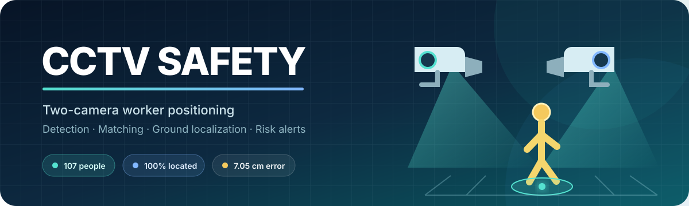
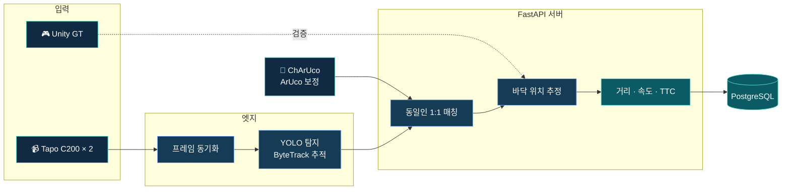
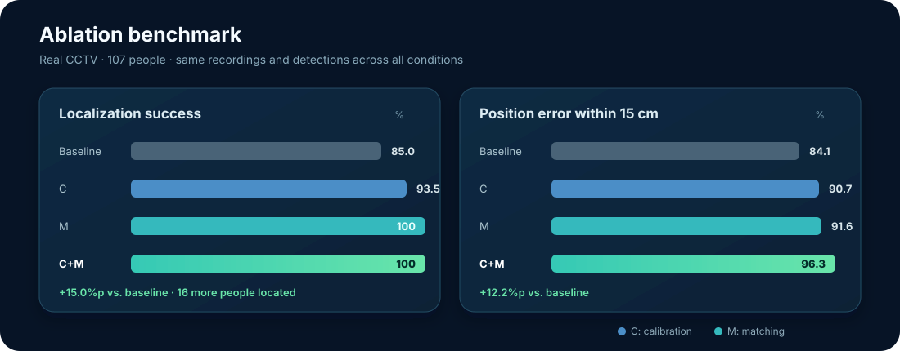

<div align="center">



### 일반 IP 카메라 2대로 작업자의 실제 바닥 위치를 추정하는 산업현장 안전 모니터링 시스템

[](https://www.python.org/)
[](https://fastapi.tiangolo.com/)
[](https://github.com/ultralytics/ultralytics)
[](unity-sim/)
[](https://github.com/geunchanKim/Comprehensive-Design-Project2-CCTV-Safety/actions/workflows/ci.yml)


[**연구 배경**](#-연구-배경) · [**주요 기능**](#-주요-기능) · [**시스템 구조**](#-시스템-구조) · [**실험 결과**](#-실험-결과) · [**빠른 시작**](#-빠른-시작) · [**실험 재현**](#-실험-재현) · [**문제 해결**](#-문제-해결)

</div>

---

## 🔎 한눈에 보기

CCTV Safety는 두 대의 **TP-Link Tapo C200** 영상에서 작업자를 탐지하고, 서로 다른 화면의 동일인을 연결해 실제 바닥 좌표를 계산합니다. 한 카메라에서 작업자가 가려진 경우에는 이전 이동 경로를 이용해 위치 소실을 보완하고, 추정 좌표로 작업자와 장비 사이의 거리 및 충돌 위험을 판단합니다.

<p align="center">
  <code>사람 탐지</code> → <code>카메라별 추적</code> → <code>동일인 매칭</code> → <code>바닥 위치 추정</code> → <code>거리·TTC</code> → <code>위험 경고</code>
</p>

### 실험 결과 요약

<table>
  <tr align="center">
    <td width="25%"><strong>107 / 107</strong><br><sub>위치 추정 성공</sub></td>
    <td width="25%"><strong>96.3%</strong><br><sub>15 cm 이내</sub></td>
    <td width="25%"><strong>7.05 cm</strong><br><sub>평균 바닥 오차</sub></td>
    <td width="25%"><strong>9 / 9</strong><br><sub>가장자리 복원</sub></td>
  </tr>
</table>

| 지표 | 기준 방법 | 제안 방법 `C+M` | 개선 |
| --- | ---: | ---: | ---: |
| 위치 추정 성공 | 91/107 (85.0%) | **107/107 (100%)** | **+16명** |
| 바닥 오차 15 cm 이내 | 84.1% | **96.3%** | **+12.2%p** |
| 평균 오차 | 7.26 cm | **7.05 cm** | −0.21 cm |
| 화면 가장자리 성공 | 0/9 | **9/9** | **전원 복원** |

> 성공률은 YOLO의 분류 정확도가 아니라, 추정 위치가 정답 좌표에서 50 cm 이내였던 **최종 바닥 위치 추정 성공률**입니다.

### 세 가지 핵심 접근

| 📐 렌즈 왜곡 보정 | 🔗 카메라 간 동일인 매칭 | 🛡️ 폐색 상황 보완 |
| --- | --- | --- |
| ChArUco로 내부 파라미터와 왜곡 계수를 추정해 화면 가장자리 좌표를 보정합니다. | 발 위치를 좌표 평면에 투영하고 헝가리안 알고리즘으로 두 화면의 작업자를 1:1 연결합니다. | 한 카메라에서 놓친 작업자는 기존 궤적의 예측 위치를 이용해 일시적인 위치 소실을 막습니다. |

> 📄 **관련 논문**<br>
> 「IP 카메라 기반 사람 위치 추정에서 렌즈 캘리브레이션과 매칭 알고리즘의 효과 분석」<br>
> 2026 한국정보기술학회 추계 종합학술대회 제출 준비

## 🎯 연구 배경

한 대의 CCTV에서 얻은 2D 화면 좌표만으로는 작업자와 장비 사이의 실제 거리를 계산하기 어렵습니다. 카메라를 두 대 사용해도 광각 렌즈의 왜곡은 화면 가장자리 좌표를 밀어내고, 가림과 밀집은 동일 작업자 대응을 어렵게 만듭니다. 이 프로젝트는 고가의 전용 센서 없이 일반 IP 카메라와 컴퓨터 비전만으로 이 문제를 해결할 수 있는지 검증합니다.

연구에서 확인하려는 질문은 두 가지입니다.

1. ChArUco 보드로 렌즈를 캘리브레이션하면 화면 가장자리의 카메라 간 매칭 실패가 해결되는가?
2. 좌표 평면 매칭·추적과 폐색 보완은 가림과 밀집 상황의 추정 실패를 해결하는가?

기존 다중 시점 연구는 대부분 왜곡이 이미 보정된 카메라를 전제로 합니다. 본 연구는 일반 IP 카메라 환경에서 **렌즈 캘리브레이션(C)**과 **매칭 알고리즘(M)**의 효과를 분리하기 위해 `기본`, `C`, `M`, `C+M` 네 조건을 동일한 녹화·탐지 결과로 비교했습니다.

> Unity는 초기 파이프라인 개발과 반복 가능한 가상 데이터 생성에 사용했습니다. 논문의 정량 결과는 렌즈 왜곡과 센서 노이즈가 포함된 **실제 촬영 영상**으로 산출했습니다.

## ✨ 주요 기능

| 영역 | 구현 내용 | 상태 |
| --- | --- | :---: |
| **탐지** | YOLO11n 객체 탐지, YOLO11n-pose 발목 추출 | ✅ 완료 |
| **추적** | 카메라별 ByteTrack, 바닥 좌표 기반 통합 ID | ✅ 완료 |
| **입력** | Unity 폴더·영상·웹캠·Tapo RTSP 스트림, 동시 녹화 | ✅ 완료 |
| **캘리브레이션** | Unity 파라미터 변환, ChArUco·ArUco 실측 보정 | ✅ 완료 |
| **매칭** | 렌즈 왜곡 보정, 에피폴라 제약, 좌표 평면 기반 1:1 대응 | ✅ 완료 |
| **위치 추정** | 발목 삼각측량, 폐색 보완(단일 카메라 투영) | ✅ 완료 |
| **안전 판단** | Kalman 속도 추정, 거리·TTC 계산, 경고 유지 | ✅ 완료 |
| **평가** | 2×2 조건별 성공률·오차·통계 검정 자동 분석 | ✅ 완료 |
| **관제 화면** | 실시간 관제 및 결과 시각화 | 🚧 개발 중 |

## 🧩 시스템 구조



| 단계 | 처리 내용 |
| --- | --- |
| 1. 입력 동기화 | 두 카메라의 수신 시각 차이가 50 ms 이내인 프레임을 한 쌍으로 구성 |
| 2. 탐지·추적 | YOLO11n으로 사람을 탐지하고 ByteTrack으로 카메라별 궤적 유지 |
| 3. 발 위치 추출 | YOLO11n-pose의 양 발목 중간점을 사용하고, 검출 실패 시 bbox 하단 중앙으로 대체 |
| 4. 동일인 매칭 | 왜곡 보정 후 에피폴라·좌표 평면 조건과 헝가리안 알고리즘으로 1:1 대응 |
| 5. 바닥 위치 추정 | 두 시점 삼각측량을 기본으로 사용하고, 한 시점 가림은 기존 경로에 한해 보완 |
| 6. 안전 판단 | 칼만 필터로 통합 ID와 속도를 추정하고 거리·충돌 예상 시간(TTC) 계산 |
| 7. 성능 평가 | 실제 영상은 실측 좌표, Unity 영상은 자동 생성된 Ground Truth와 비교 |

<details>
<summary><strong>매칭·폐색 보완 세부 기준</strong></summary>

- 기준 방법은 에피폴라 거리 50 px 이내이고 삼각측량한 발 높이가 허용 범위에 있는 쌍을 연결합니다.
- 개선 방법은 두 카메라의 발 위치를 좌표 평면에 각각 투영한 뒤, 가까운 후보를 1:1로 연결합니다.
- 양쪽 카메라에 보이면 삼각측량합니다. 한쪽에만 보이면 해당 카메라의 시선을 평면에 투영하고, 기존 경로의 예측 위치에서 0.8 m 이내일 때만 보완합니다.
- 단일 카메라 보완은 일시적인 위치 소실을 막는 기능이며, 새로운 경로를 생성하지 않습니다.

</details>

## 📊 실험 결과

> 아래 내용은 논문 「IP 카메라 기반 사람 위치 추정에서 렌즈 캘리브레이션과 매칭 알고리즘의 효과 분석」의 실험 결과입니다.



### 실험 구성

| 항목 | 내용 |
| --- | --- |
| 카메라 | TP-Link Tapo C200 2대, RTSP 1920×1080, 30 fps |
| 설치 높이 | 약 1.9 m, 1.8 m (서로 다른 방향) |
| 실험 공간 | 실내 4 m × 4 m 바닥, 1 m 간격 십자 마커 25개(5×5), 원점은 ArUco ID 0 |
| 데이터 | 10개 시나리오, 15회 녹화, 십자 마커 위 정지 장면 50개 |
| 평가 대상 | 사람 107명 |
| 성공 판정 | 정답 위치와 1:1 매칭 후 50 cm 이내 (십자 간격의 절반) |
| 통계 검정 | Wilcoxon 부호순위 검정, ±2 cm 범위 TOST 동등성 검정 |

렌즈 캘리브레이션(`C`)과 매칭 알고리즘(`M`)의 효과를 분리하기 위해 네 조건을 비교했습니다. 모든 조건은 같은 녹화와 검출 결과를 첫 프레임부터 순서대로 처리합니다.

| 조건 | 렌즈 캘리브레이션 | 매칭 알고리즘 |
| --- | :---: | :---: |
| 기본 | X | X |
| C | O | X |
| M | X | O |
| C+M | O | O |

- **렌즈 캘리브레이션**: ChArUco 보드로 초점거리·주점·왜곡 계수를 추정하고, 검출한 발 위치를 왜곡이 없을 때의 위치로 보정합니다. 사용한 카메라는 왜곡으로 밀려나는 거리가 영상 중심에서 약 4 px, 모서리에서 100 px를 넘습니다.
- **매칭 알고리즘**: 좌표 평면 매칭, 칼만 필터 기반 좌표 평면 추적, 폐색 보완으로 구성합니다.

### 조건별 결과

| 지표 | 기본 | C | M | C+M |
| --- | ---: | ---: | ---: | ---: |
| 추정 성공률 (%) | 85.0 | 93.5 | 100 | **100** |
| 평균 오차 (cm) | 7.26 | 6.89 | 8.39 | 7.05 |
| P90 오차 (cm) | 12.2 | 11.7 | 13.3 | 11.8 |
| 15 cm 이내 (%) | 84.1 | 90.7 | 91.6 | **96.3** |

### 영상 내 위치별 결과

주점에서 정답 지점까지의 정규화 거리(0: 중심, 1: 모서리)로 구간을 나누고, 두 카메라 중 큰 값을 사용했습니다.

| 구간 | 지표 | 기본 | C | M | C+M |
| --- | --- | ---: | ---: | ---: | ---: |
| 가운데 (< 0.5, 60명) | 추정 성공 (명) | 53 | 53 | 60 | 60 |
| | 평균 오차 (cm) | 7.09 | 6.05 | 7.12 | 6.37 |
| 바깥쪽 (0.5~0.7, 38명) | 추정 성공 (명) | 38 | 38 | 38 | 38 |
| | 평균 오차 (cm) | 7.49 | 7.52 | 7.48 | 7.50 |
| 가장자리 (≥ 0.7, 9명) | 추정 성공 (명) | 0 | 9 | 9 | 9 |
| | 평균 오차 (cm) | — | 9.17 | 20.68 | 9.71 |

### 결과 해석

- **렌즈 캘리브레이션 → 가장자리 매칭 실패 해결.** 십자 마커 재투영 오차가 cam1 13.6 → 5.9 px, cam2 6.6 → 5.0 px로 줄었습니다. 가장자리 9명의 에피폴라 거리는 55~96 px에서 0.3~13.8 px로 줄어 기준 50 px 안에 들어왔고, 9명 모두 매칭에 성공했습니다(성공률 85.0% → 93.5%).
- **매칭 알고리즘 → 폐색·밀집으로 인한 추정 실패 해결.** 기준 방법이 놓친 16명을 추가로 추정해 107명 전원의 위치를 구했습니다. 가장자리 9명과 밀집 장면 1명은 좌표 평면 매칭으로, 6명은 폐색 보완으로 찾았습니다. 기준 방법이 추정한 91명의 오차는 7.26 cm와 7.22 cm로 실질적으로 같았습니다(TOST p < 0.001).
- **두 방법의 결합 → 서로의 한계 보완.** 매칭 알고리즘만 쓰면 왜곡을 보정하지 않은 가장자리 오차가 20.68 cm로 컸지만, 렌즈 캘리브레이션을 더하면 9.71 cm로 줄었습니다. 같은 107명의 평균 오차도 8.39 → 7.05 cm로 감소했습니다(Wilcoxon p = 0.031).

> **매칭 알고리즘은 추정 가능한 대상을 늘리고, 렌즈 캘리브레이션은 특히 화면 가장자리의 정확도를 회복합니다.** 가운데 구간에서 캘리브레이션으로 줄어든 약 1 cm는 통계적 차이가 있었지만(Wilcoxon p = 0.034), ±2 cm 동등성 범위 안에서는 실질적으로 같은 수준이었습니다(TOST p = 0.020).

### 한계

- 가장자리 결과는 두 십자 마커 위의 9명에 한정됩니다.
- 평가는 한 장소의 정지 장면에서만 수행했으며, 보행 장면의 실시간 위치 정확도와 추적 성능 평가는 향후 과제입니다.

## 🚀 빠른 시작

> 아래 명령 블록은 각각 **저장소 루트에서 시작하는 새 터미널**을 기준으로 작성했습니다.

### 실행 경로 선택

| 목적 | 권장 경로 | 필요한 구성 |
| --- | --- | --- |
| 파이프라인을 빠르게 확인 | [Unity 샘플 Dry Run](#3-서버-없이-먼저-확인하기) | Python, 모델 가중치, Unity 출력 폴더 |
| API·DB까지 통합 실행 | [Docker Compose 실행](#4-백엔드와-데이터베이스-실행) | 위 구성 + Docker Desktop |
| 실제 CCTV 연결 | [카메라 캘리브레이션](#-실제-카메라-캘리브레이션) | Tapo C200 2대, ChArUco·ArUco 보드 |

### 준비 사항

- Python 3.11 이상
- Docker Desktop 및 Docker Compose
- Git

### 1. 저장소와 서브모듈 받기

```bash
git clone --recurse-submodules https://github.com/geunchanKim/Comprehensive-Design-Project2-CCTV-Safety.git
cd Comprehensive-Design-Project2-CCTV-Safety
```

이미 저장소를 받았다면 저장소 루트에서 `git submodule update --init --recursive`만 실행하면 됩니다.

### 2. AI 환경 준비

```powershell
cd ai
python -m venv .venv
.\.venv\Scripts\Activate.ps1
pip install -r requirements.txt
```

v2 모델 가중치를 `ai/runs/train_v2/weights/best.pt`에 둡니다. 직접 학습하려면 데이터셋을 준비한 뒤 `python train.py --version v2`를 실행합니다.

### 3. 서버 없이 먼저 확인하기

Unity 출력 폴더는 아래 구조를 사용합니다.

```text
unity-classroom-01/
├── cam1/000001.jpg
├── cam2/000001.jpg
├── frames.jsonl
└── cameras.json
```

Unity 샘플이 준비되어 있다면 서버를 띄우기 전에 탐지와 메시지 생성까지 먼저 확인할 수 있습니다.

```powershell
cd ai
python edge/unity_reader.py <Unity_출력_폴더> --dry-run --max-frames 10 --save-every 1
```

결과는 `ai/runs/edge/<session_id>/`에 저장됩니다.

### 4. 백엔드와 데이터베이스 실행

`infra/.env` 파일을 만들고 아래 값을 입력합니다. 비밀번호는 로컬 환경에 맞게 바꿔 주세요.

```dotenv
POSTGRES_USER=cctv_user
POSTGRES_PASSWORD=change-me
POSTGRES_DB=cctv_safety_db
PGADMIN_DEFAULT_EMAIL=admin@example.com
PGADMIN_DEFAULT_PASSWORD=change-me
BACKEND_PORT=8000
PGADMIN_PORT=5050

# 선택: 위치 추정 알고리즘 설정
MAX_EPIPOLAR_ERROR_PX=50
BOX_FOOT_Z_MIN=-0.35
BOX_FOOT_Z_MAX=0.2
ANKLE_FOOT_Z_MIN=-0.1
ANKLE_FOOT_Z_MAX=0.4
BBOX_POSITION_METHOD=triangulate
```

```powershell
cd infra
docker compose up --build
```

- API 상태: <http://localhost:8000/health>
- Swagger UI: <http://localhost:8000/docs>
- pgAdmin: <http://localhost:5050>

### 5. 백엔드까지 연결해 실행하기

```powershell
cd ai
python edge/unity_reader.py <Unity_출력_폴더> --server http://localhost:8000 --calib auto
```

실행할 때마다 폴더 이름에 `-runN`이 붙은 새 `session_id`가 만들어집니다. 엣지는 두 카메라의 캘리브레이션을 먼저 등록한 뒤 탐지 결과와 정답 좌표를 전송합니다.

## 📐 실제 카메라 캘리브레이션

실제 CCTV는 ChArUco 보드로 내부 파라미터를 계산하고, 두 카메라가 함께 보는 18 cm ArUco 마커로 공통 월드 좌표계를 설정합니다.

```powershell
cd ai/calibration
pip install -r requirements.txt

python generate_charuco_board.py
python generate_aruco_markers.py
python capture_charuco.py --camera-id cam1
python calibrate_camera.py --camera-id cam1 --images captures/cam1

python capture_images.py --camera-id cam1 --marker-id 0
python detect_aruco.py `
  --camera-id cam1 `
  --session-id cctv-classroom-01-run1 `
  --intrinsics output/cam1_intrinsics.json `
  --images captures/aruco/cam1 `
  --backend-url http://localhost:8000
```

카메라 2도 같은 `session_id`와 움직이지 않은 기준 마커를 사용해야 합니다. 전체 절차는 [실제 카메라 캘리브레이션 안내](ai/calibration/README.md)를 확인하세요.

## 🔌 API 요약

| Method | Endpoint | 설명 |
| --- | --- | --- |
| `GET` | `/health` | 서버 상태 확인 |
| `GET` | `/health/db` | 데이터베이스 연결 확인 |
| `PUT` | `/cameras/{camera_id}/calibration` | 세션별 카메라 캘리브레이션 등록 |
| `POST` | `/detections` | 동기화된 두 카메라의 탐지 묶음 처리 |
| `POST` | `/ground-truth` | Unity 정답 좌표 저장 |

- 월드 좌표는 `[X, Y, Z]`, 단위는 m이며 Z가 높이입니다.
- Unity의 `(x, y, z)`는 엣지에서 `(x, z, y)`로 변환합니다.
- 바운딩 박스(bbox)는 비정규화 픽셀 좌표 `[x1, y1, x2, y2]`입니다.
- 두 프레임의 기본 허용 시간 차이는 50 ms입니다.
- 기본 에피폴라 매칭 허용 오차는 50 px이며 `MAX_EPIPOLAR_ERROR_PX`로 변경할 수 있습니다.

전체 계약과 요청·응답 예시는 [메시지 명세](docs/specs/message-spec.md)와 [탐지·삼각측량 API 문서](docs/detections-api.md)를 참고하세요.

### 주요 설정값

| 환경변수 | 기본값 | 설명 |
| --- | ---: | --- |
| `MAX_EPIPOLAR_ERROR_PX` | `50` | 동일인 후보로 허용할 최대 에피폴라 거리(px) |
| `BOX_FOOT_Z_MIN` / `BOX_FOOT_Z_MAX` | `-0.35` / `0.2` | bbox 하단점 삼각측량의 허용 높이 범위(m) |
| `ANKLE_FOOT_Z_MIN` / `ANKLE_FOOT_Z_MAX` | `-0.1` / `0.4` | 발목 중간점 삼각측량의 허용 높이 범위(m) |
| `BBOX_POSITION_METHOD` | `triangulate` | bbox 위치 계산 방식: `triangulate` 또는 `plane` |

현재 적용된 서버 설정은 `GET /health` 응답에서 확인할 수 있습니다. 실험 결과를 비교할 때는 코드 커밋뿐 아니라 이 설정값도 함께 기록해야 합니다.

## ✅ 테스트

```powershell
pip install -r backend/requirements.txt
python -m pytest backend/tests -q
```

테스트는 발목·바운딩 박스의 바닥 접점, 왜곡 보정, 사람 매칭, 바닥 평면 투영, 삼각측량, 캘리브레이션 등록, 세션별 객체 ID, 중복·동기화 검증과 정답 좌표 저장을 확인합니다.

GitHub Actions는 `develop`·`main` 브랜치의 push와 PR마다 다음 검증을 자동 수행합니다.

| 작업 | 검증 내용 |
| --- | --- |
| `backend-test` | Python 3.11, SQLite 환경에서 백엔드 테스트 실행 |
| `edge-test` | AI·평가 코드 문법 검사와 엣지 테스트 실행 |

## 🔁 실험 재현

탐지 결과를 압축한 **experiment pack**을 서버에 다시 전송하면 YOLO 추론을 반복하지 않고도 동일 입력으로 위치 추정 알고리즘을 비교할 수 있습니다. 저장소에는 `s1`~`s4`의 bbox·발목 기준 pack이 포함되어 있습니다.

### 1. 로컬 서버 준비

[백엔드와 데이터베이스 실행](#4-백엔드와-데이터베이스-실행)에 따라 API를 실행하고 `/health` 응답을 확인합니다.

### 2. 저장된 pack으로 평가

```powershell
cd ai
python eval/run_experiment.py run `
  --server http://localhost:8000 `
  --packs s1,s2,s3,s4 `
  --label local-baseline
```

### 3. 변경 전후 비교

알고리즘을 수정한 뒤 같은 명령에 `--compare latest`를 추가하면 직전 결과와 현재 결과를 같은 표에서 비교합니다.

```powershell
python eval/run_experiment.py run `
  --server http://localhost:8000 `
  --packs s1,s2,s3,s4 `
  --label local-after-change `
  --compare latest
```

결과는 `ai/runs/experiments/<label>/`에 저장됩니다.

| 결과 파일 | 내용 |
| --- | --- |
| `summary.md` | PR·GitHub Actions 요약에 바로 사용할 수 있는 비교표 |
| `summary.csv` | pack·클래스별 성공 수, 평균·P90 오차, 누락·오매칭률 |
| `meta.json` | 서버 커밋, 설정, 평가 기준과 실행 시각 |
| `<pack>/position_errors.csv` | 객체별 위치 오차와 상세 평가 결과 |

> 이 pack 평가는 서버 알고리즘의 반복 비교를 위한 도구입니다. 논문에 제시한 사람 107명의 실제 CCTV 2×2 실험과 Unity pack 평가는 데이터셋과 목적이 다릅니다.

## 🧰 문제 해결

| 증상 | 원인 | 해결 방법 |
| --- | --- | --- |
| `가중치 파일이 없어요` | `v2` 모델 파일이 지정 위치에 없음 | `ai/runs/train_v2/weights/best.pt`에 가중치를 두거나 `--model coco`로 먼저 실행 |
| `/health`는 되지만 `/health/db` 실패 | PostgreSQL 미기동 또는 `.env` 접속 정보 불일치 | `infra`에서 `docker compose ps`와 `docker compose logs db backend` 확인 |
| 탐지 전송 시 `404` | 해당 `session_id`의 카메라 캘리브레이션이 없음 | 같은 세션으로 cam1·cam2 캘리브레이션을 먼저 등록 |
| 재전송 시 `409` | 같은 `session_id`와 `pair_id` 또는 frame이 이미 저장됨 | 새 `session_id` 사용. `unity_reader.py`는 기본적으로 `-runN`을 자동 증가 |
| 탐지 전송 시 `422` | 두 프레임의 시간 차이가 50 ms를 초과하거나 요청 형식이 잘못됨 | 프레임 동기화와 `/docs`의 요청 스키마 확인 |
| 가장자리 작업자가 매칭되지 않음 | 왜곡 보정 누락 또는 에피폴라 거리 초과 | ChArUco 보정 적용 여부와 `/health`의 `max_epipolar_error_px` 확인 |
| 결과가 생성되지 않음 | 입력 이미지 누락·손상 또는 서버 요청 실패 | 실행 결과 폴더의 `failed.jsonl`과 `sent_*.jsonl` 확인 |

문제가 계속되면 다음 정보를 함께 확인하면 원인을 빠르게 좁힐 수 있습니다.

```powershell
Invoke-RestMethod http://localhost:8000/health
Invoke-RestMethod http://localhost:8000/health/db
cd infra
docker compose ps
docker compose logs --tail 100 backend
```

## 🗂️ 저장소 구성

```text
.
├── ai/
│   ├── calibration/       # 실제 카메라 캘리브레이션
│   ├── configs/           # YOLO 데이터셋 설정
│   ├── edge/              # 탐지·추적, 입력 처리, 서버 전송
│   ├── eval/              # 재현용 pack, 평가·비교 자동화
│   ├── scripts/           # 데이터 병합·자동 라벨링 도구
│   └── train.py           # YOLO 학습 진입점
├── backend/               # FastAPI, DB 모델, 테스트
├── docs/                  # 회의 기록, 명세, API 문서
├── infra/                 # PostgreSQL·Backend Docker Compose
└── unity-sim/             # Unity 시뮬레이터 서브모듈
```

## 🗺️ 진행 상황과 다음 단계

- [x] 실제 Tapo CCTV 두 대의 동시 녹화·연동
- [x] 렌즈 캘리브레이션 × 매칭 알고리즘 2×2 실험
- [x] 10개 시나리오·15개 녹화의 실측 위치 평가
- [x] 좌표 평면 매칭·추적과 폐색 보완
- [x] 거리·속도 기반 TTC 계산과 위험 경고 유지
- [x] 논문 결과 기반 중간발표 자료 정리
- [ ] 논문 교정 및 학회 제출
- [ ] 보행 장면의 추적·경고 정량 평가
- [ ] 여러 장소·가장자리 표본 확대 평가
- [ ] 실시간 관제 UI 완성

## 📚 문서 모음

- [AI 학습 안내](ai/README.md)
- [실제 카메라 캘리브레이션](ai/calibration/README.md)
- [Unity·Edge·Backend 메시지 명세](docs/specs/message-spec.md)
- [탐지·삼각측량 API](docs/detections-api.md)
- [협업 및 커밋 규칙](CONVENTION.md)

## 👥 팀

| 이름 | 주요 역할 |
| --- | --- |
| 김근찬 | AI 탐지 모델, 엣지 파이프라인, 좌표 추정 |
| 조해민 | 백엔드 API, 데이터 처리, 카메라 캘리브레이션 |
| 서성윤 | Unity 가상환경, 데이터 생성, 결과 시각화 |
| 양영준·박주환·김채현 | 프로젝트 자문 및 공동 연구 |
| 손희문 부장 | 산업현장 요구사항 및 환경 자료 자문 |

## ⚠️ 안내

이 프로젝트는 종합설계프로젝트 연구용 프로토타입입니다. 계산 결과는 현장 안전관리자의 판단을 보조하기 위한 것이며, 단독으로 작업자의 안전을 보장하지 않습니다.
