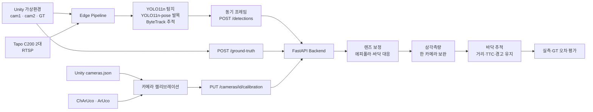

# CCTV Safety

> 저가 IP 카메라 2대에서 작업자를 탐지·추적하고 바닥 위치를 추정하는 산업현장 안전 모니터링 프로젝트


## Overview

CCTV Safety는 TP-Link Tapo C200 두 대의 RTSP 영상에서 작업자를 검출하고, 서로 다른 카메라에 나타난 같은 작업자를 연결하여 실제 바닥 위치를 추정합니다. YOLO11n과 YOLO11n-pose로 사람과 발목을 찾고, ByteTrack으로 카메라별 궤적을 만든 뒤 렌즈 보정, 다중 카메라 대응, 바닥 추적을 적용합니다.

연구의 핵심 질문은 다음 두 가지입니다.

1. ChArUco 보드로 광각 렌즈를 캘리브레이션하는 수고가 실제 위치 추정에 도움이 되는가?
2. 바닥 기반 대응·추적과 한 카메라 보완을 적용하면 가림과 혼잡 상황에서 무엇이 개선되는가?

실제 촬영 실험과 분석을 완료했으며, 현재 결과를 바탕으로 논문을 작성하고 있습니다. Unity는 초기 파이프라인 개발, 반복 가능한 가상 데이터 생성, Ground Truth 기반 검증에 사용합니다.

### 실제 카메라 실험 결과

| 항목 | 결과 |
| --- | --- |
| 카메라 | Tapo C200 2대, 1920×1080, 30 fps |
| 설치 높이 | 1.92 m, 1.83 m |
| 실험 데이터 | 10개 시나리오, 15개 녹화, 정지 장면 50개 |
| 평가 대상 | 사람 107명, 의자 52개 |
| 렌즈 보정 재투영 오차 | cam1 13.6 → 5.9 px, cam2 6.6 → 5.0 px |
| 화면 가장자리 사람 | 기본 방법 0/9 → 렌즈 보정 후 9/9 위치 추정 성공 |
| 최종 사람 위치 추정 | 107명 중 99% 성공, 92.5%가 바닥 오차 15 cm 이내 |
| 현장 기록 69명 평균 오차 | 개선 알고리즘만 9.0 cm → 렌즈 보정 병행 8.4 cm |
| 현장 기록 69명 상위 10% 오차 | 16.2 cm → 13.7 cm |

> 성공은 추정 위치가 정답 십자 좌표에서 50 cm 이내인 경우입니다. `99%`는 YOLO의 일반적인 분류 정확도가 아니라 최종 바닥 위치 추정 성공률입니다.

렌즈 보정은 화면 중앙의 오차를 조금 줄이는 것보다 화면 가장자리에서 두 카메라의 작업자를 대응시키는 데 더 큰 효과가 있었습니다. 개선 알고리즘은 기존에 찾던 사람의 정확도를 유지하면서 기본 방법이 놓친 18명을 바닥 대응 12명, 한 카메라 보완 6명으로 추가 복원했습니다.

## Architecture



1. Unity 폴더 또는 실제 CCTV에서 두 카메라 영상을 가져오고, 촬영 시각 차이가 50 ms 이내인 프레임을 묶습니다.
2. 카메라마다 YOLO11n 탐지와 ByteTrack 추적을 수행합니다.
3. 사람은 YOLO11n-pose의 좌우 발목 중간점을 바닥 접점으로 사용하고, 발목을 찾지 못하면 bbox 하단 중앙으로 대체합니다.
4. 렌즈 왜곡을 보정한 뒤 에피폴라 제약과 바닥 평면상의 거리를 이용해 같은 작업자를 연결합니다.
5. 양쪽 카메라에 보이면 삼각측량하고, 한쪽에만 보이면 카메라 시선과 발목 높이 평면의 교점으로 위치를 보완합니다.
6. 바닥 좌표에 통합 추적 ID를 부여하고 거리·속도·TTC를 계산합니다.
7. 실제 촬영은 테이프 십자 실측 좌표, Unity 실험은 Ground Truth와 비교해 위치 오차를 평가합니다.

## Features

| 영역 | 구현 내용 | 상태 |
| --- | --- | :---: |
| AI | YOLO11n 객체 탐지, YOLO11n-pose 발목 추출 | ✅ |
| Tracking | 카메라별 ByteTrack 및 바닥 좌표 통합 추적 | ✅ |
| Edge | Unity 폴더·영상·웹캠·Tapo RTSP 입력, 동시 녹화, 서버 전송 | ✅ |
| Calibration | Unity 파라미터 변환, 실제 CCTV ChArUco·ArUco 캘리브레이션 | ✅ |
| Matching | 렌즈 보정, 에피폴라 제약, 바닥 기반 1:1 대응 | ✅ |
| Position | 발목 삼각측량 및 한 카메라 누락 보완 | ✅ |
| Evaluation | 2×2 조건 실험, 위치 오차·놓침·오매칭·ID 전환 자동 평가 | ✅ |
| Safety | Kalman 속도 추정, 거리·TTC, 위험 경고 유지 | ✅ |
| UI | 실시간 관제 및 결과 시각화 | 🚧 |

## Experiment

실제 실험은 렌즈 캘리브레이션(`C`)과 개선 알고리즘(`A`)의 효과를 분리하기 위해 2×2 조건으로 비교했습니다.

| 조건 | 렌즈 캘리브레이션 | 개선 알고리즘 |
| --- | :---: | :---: |
| 기본 | X | X |
| C | O | X |
| A | X | O |
| C+A | O | O |

`A`는 다음 네 기능의 묶음입니다.

- **바닥 대응**: 각 발 위치를 바닥 평면에 투영하고 2 m 이내의 가장 가까운 사람을 두 카메라 사이에서 연결합니다.
- **바닥 추적**: 카메라별 ID 대신 바닥 위 궤적에 통합 ID를 부여합니다.
- **한 카메라 보완**: 한 카메라에만 보이면 시선과 높이 0.15 m 평면의 교점으로 위치를 추정합니다.
- **경고 유지**: 거리가 1.0 m 미만이면 경고를 켜고 1.1 m 이상에서 꺼 경계 부근의 깜빡임을 줄입니다.

사람 정답은 ArUco ID 0 중심을 원점으로 설치한 1 m 간격 테이프 십자의 실측 좌표입니다. 정답과 추정 결과를 1:1 배정하고 50 cm 이내면 성공으로 판정했습니다. 이미 찾던 사람의 위치 오차는 Wilcoxon 검정과 ±2 cm 동등성 검정(TOST)으로 비교했습니다.

### 연구 결론과 한계

- 렌즈 캘리브레이션은 특히 광각 화면 가장자리의 대응 실패를 해결했습니다.
- 개선 알고리즘은 기존 위치 정확도를 유지하면서 가림·혼잡·단일 카메라 검출 상황의 재현율을 높였습니다.
- 두 개선은 서로 다른 실패 원인을 해결하므로 함께 적용하는 것이 가장 효과적이었습니다.
- 가장자리 평가는 9명과 두 위치에 한정되며, 현재 논문은 정지 장면을 중심으로 평가했습니다.
- 의자는 카메라마다 bbox 하단이 서로 다른 다리를 가리켜 성공률 개선이 65%에서 69%로 제한적이었습니다.
- 향후 걷는 장면의 추적·경고 평가와 한 카메라 보완의 고정 발목 높이 가정을 개선할 예정입니다.

## Repository

```text
.
├── ai/
│   ├── calibration/       # ChArUco·ArUco 실제 카메라 캘리브레이션
│   ├── configs/           # YOLO 데이터셋 설정
│   ├── edge/              # 탐지·추적, Unity 입력, 서버 전송
│   ├── scripts/           # 데이터 병합·자동 라벨링 도구
│   └── train.py           # YOLO 학습 진입점
├── backend/
│   ├── alembic/           # 데이터베이스 마이그레이션
│   ├── tests/             # API·기하 계산 테스트
│   ├── api.py             # FastAPI 엔드포인트
│   ├── geometry.py        # 매칭·삼각측량
│   └── models.py          # SQLAlchemy 모델
├── docs/
│   ├── meeting-notes/     # 회의 기록
│   ├── specs/             # Unity·Edge·Backend 메시지 계약
│   └── detections-api.md  # 탐지·삼각측량 API 설명
├── infra/                 # PostgreSQL·Backend Docker Compose
└── unity-sim/             # Unity 시뮬레이터 서브모듈
```

## Quick Start

### 1. 저장소 받기

```bash
git clone --recurse-submodules https://github.com/geunchanKim/Comprehensive-Design-Project2-CCTV-Safety.git
cd Comprehensive-Design-Project2-CCTV-Safety
```

이미 저장소를 받은 경우 Unity 서브모듈을 초기화합니다.

```bash
git submodule update --init --recursive
```

### 2. AI 환경 준비

```powershell
cd ai
python -m venv .venv
.\.venv\Scripts\Activate.ps1
pip install -r requirements.txt
```

v2 모델 가중치를 `ai/runs/train_v2/weights/best.pt`에 준비합니다. 직접 학습하려면 데이터셋을 준비한 뒤 실행합니다.

```powershell
python train.py --version v2
```

### 3. Unity 샘플 dry-run

Unity 출력은 다음 구조를 사용합니다.

```text
unity-classroom-01/
├── cam1/000001.jpg
├── cam2/000001.jpg
├── frames.jsonl
└── cameras.json
```

서버로 보내지 않고 탐지·메시지 생성까지만 확인합니다.

```powershell
cd ai
python edge/unity_reader.py <Unity_출력_폴더> --dry-run --max-frames 10 --save-every 1
```

결과는 `ai/runs/edge/<session_id>/`에 저장됩니다.

```text
sent_calibration.jsonl
sent_detections.jsonl
sent_ground-truth.jsonl
failed.jsonl
vis/
```

### 4. 백엔드 실행

`infra/.env` 파일을 만듭니다.

```dotenv
POSTGRES_USER=cctv_user
POSTGRES_PASSWORD=change-me
POSTGRES_DB=cctv_safety_db
PGADMIN_DEFAULT_EMAIL=admin@example.com
PGADMIN_DEFAULT_PASSWORD=change-me
BACKEND_PORT=8000
PGADMIN_PORT=5050
```

Docker Compose로 PostgreSQL과 FastAPI를 실행합니다.

```powershell
cd infra
docker compose up --build
```

- API 상태: `http://localhost:8000/health`
- Swagger UI: `http://localhost:8000/docs`
- pgAdmin: `http://localhost:5050`

### 5. 전체 파이프라인 실행

```powershell
cd ai
python edge/unity_reader.py <Unity_출력_폴더> --server http://localhost:8000 --calib auto
```

실행할 때마다 폴더 이름에 `-runN`이 붙은 새 `session_id`가 생성됩니다. 엣지는 해당 세션의 cam1·cam2 캘리브레이션을 먼저 등록하고, 이후 탐지 결과와 Ground Truth를 전송합니다.

## Real Camera Calibration

실제 CCTV는 ChArUco 보드로 내부 파라미터를 계산하고, 두 카메라가 함께 보는 18cm ArUco 마커로 공통 월드 좌표계를 설정합니다.

```powershell
cd ai/calibration
pip install -r requirements.txt

python generate_charuco_board.py
python generate_aruco_markers.py

python capture_charuco.py --camera-id cam1
python calibrate_camera.py --camera-id cam1 --images captures/cam1

python capture_images.py --camera-id cam1 --marker-id 0
python detect_aruco.py `
  --camera-id cam1 `
  --session-id cctv-classroom-01-run1 `
  --intrinsics output/cam1_intrinsics.json `
  --images captures/aruco/cam1 `
  --backend-url http://localhost:8000
```

cam2도 같은 `session_id`와 움직이지 않은 기준 마커를 사용해야 합니다. 자세한 촬영 조건은 [`ai/calibration/README.md`](ai/calibration/README.md)를 참고하세요.

## API Summary

| Method | Endpoint                           | 설명                              |
| ------ | ---------------------------------- | --------------------------------- |
| `GET`  | `/health`                          | 서버 상태 확인                    |
| `GET`  | `/health/db`                       | 데이터베이스 연결 확인            |
| `PUT`  | `/cameras/{camera_id}/calibration` | 세션별 카메라 캘리브레이션 등록   |
| `POST` | `/detections`                      | 동기화된 두 카메라 탐지 묶음 처리 |
| `POST` | `/ground-truth`                    | Unity 정답 좌표 저장              |

핵심 규칙:

- 월드 좌표는 `[X, Y, Z]`, 단위는 m, Z는 높이입니다.
- Unity `(x, y, z)`는 엣지에서 `(x, z, y)`로 변환합니다.
- bbox는 비정규화 픽셀 좌표 `[x1, y1, x2, y2]`입니다.
- 두 프레임의 기본 허용 시간 차이는 50 ms입니다.
- 기본 에피폴라 매칭 허용 오차는 30 px이며 `MAX_EPIPOLAR_ERROR_PX`로 변경할 수 있습니다.

전체 계약은 [`docs/specs/message-spec.md`](docs/specs/message-spec.md), 요청·응답 예시는 [`docs/detections-api.md`](docs/detections-api.md)를 참고하세요.

## Tests

```powershell
python -m pytest backend/tests -q
```

현재 테스트는 발목·bbox 바닥 접점, 왜곡 보정, 2단계 사람 대응, 바닥 평면 투영, 삼각측량, 캘리브레이션 등록, 세션별 객체 ID, 중복·동기화 검증과 Ground Truth 저장을 확인합니다.

## Roadmap

- [x] YOLO v2 학습 파이프라인
- [x] Unity 폴더 기반 엣지 파이프라인
- [x] 카메라별 ByteTrack 추적
- [x] 세션별 카메라 캘리브레이션 등록
- [x] 에피폴라 매칭과 3D 삼각측량 API
- [x] ChArUco·ArUco 실제 카메라 캘리브레이션 도구
- [x] Unity GT 대비 프레임별 위치 오차 자동 평가
- [x] 실제 Tapo CCTV 두 대 동시 녹화·연동
- [x] 렌즈 보정 유무 × 개선 알고리즘 유무 2×2 실험
- [x] 10개 시나리오·15개 녹화의 실측 위치 평가
- [x] 바닥 대응·추적과 한 카메라 누락 보완
- [x] 거리·속도 기반 TTC 및 위험 경고 유지
- [ ] 논문 교정 및 학회 제출
- [ ] 걷는 장면의 추적·경고 정량 평가
- [ ] 한 카메라 보완의 고정 발목 높이 가정 개선
- [ ] 의자·장비 바닥 접점 추정 개선
- [ ] 실시간 관제 UI 완성

## Documentation

- [AI 학습 안내](ai/README.md)
- [실제 카메라 캘리브레이션](ai/calibration/README.md)
- [Unity·Edge·Backend 메시지 명세](docs/specs/message-spec.md)
- [탐지·삼각측량 API](docs/detections-api.md)
- [협업 및 커밋 규칙](CONVENTION.md)

## Team

| 이름                 | 주요 역할                                    |
| -------------------- | -------------------------------------------- |
| 김근찬               | AI 탐지 모델, 엣지 파이프라인, 좌표 추정     |
| 조해민               | 백엔드 API, 데이터 처리, 카메라 캘리브레이션 |
| 서성윤               | Unity 가상환경, 데이터 생성, 결과 시각화     |
| 양영준·박주환·김채현 | 프로젝트 자문 및 공동 연구                   |
| 손희문 부장          | 산업현장 요구사항 및 환경 자료 자문          |

## Notice

이 프로젝트는 종합설계프로젝트 연구용 프로토타입입니다. 계산 결과는 현장 안전관리자의 판단을 보조하기 위한 것이며, 단독으로 작업자의 안전을 보장하지 않습니다.
