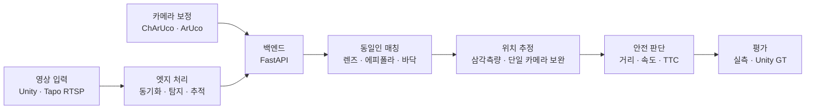

# CCTV Safety

> 저가형 IP 카메라 2대로 작업자를 탐지·추적하고, 실제 바닥 위치와 충돌 위험을 추정하는 산업현장 안전 모니터링 시스템


## 한눈에 보기

CCTV Safety는 두 대의 **TP-Link Tapo C200**에서 들어오는 영상을 분석해 작업자의 실제 바닥 좌표를 계산합니다. 화면 속 사람을 찾는 데서 끝나지 않고, 서로 다른 카메라에 잡힌 같은 사람을 연결하고 한쪽 카메라에서 놓친 사람까지 보완합니다.

`사람 탐지` → `카메라별 추적` → `동일인 매칭` → `바닥 위치 추정` → `거리·TTC 계산` → `위험 경고`

| 문제 | 접근 | 검증 |
| --- | --- | --- |
| 가림, 혼잡, 광각 렌즈 왜곡 때문에 한 화면만으로 정확한 위치를 알기 어려움 | 발목 기반 삼각측량, 바닥 좌표 매칭, 단일 카메라 보완 | 실제 CCTV 15개 녹화와 Unity 정답 데이터로 위치 오차 평가 |

| 실제 카메라 실험 | 결과 |
| --- | ---: |
| 최종 위치 추정 성공률 | **99%** (107명 대상) |
| 바닥 오차 15 cm 이내 | **92.5%** |
| 현장 기록 69명 평균 오차 | **9.0 cm → 8.4 cm** |
| 화면 가장자리 위치 추정 | **0/9 → 9/9 성공** |
| 추가로 복원한 작업자 | **18명** |

> 여기서 99%는 YOLO의 분류 정확도가 아니라, 추정 위치가 정답 좌표에서 50 cm 이내였던 **최종 바닥 위치 추정 성공률**입니다.

**바로가기** · [주요 기능](#주요-기능) · [시스템 구조](#시스템-구조) · [실험 결과](#실험-결과) · [빠른 시작](#빠른-시작) · [API](#api-요약)

## 왜 이 프로젝트를 만들었나

산업현장에서는 한 대의 CCTV만으로 작업자의 정확한 위치를 알기 어렵습니다. 사람이나 장비에 가려지기도 하고, 광각 렌즈 때문에 화면 가장자리 좌표가 크게 어긋나기도 합니다. 이 프로젝트는 고가의 전용 센서 대신 일반 IP 카메라 두 대와 컴퓨터 비전만으로 이 문제를 얼마나 해결할 수 있는지 검증합니다.

연구에서 확인하려는 질문은 두 가지입니다.

1. ChArUco 보드로 광각 렌즈를 캘리브레이션하면 실제 위치 추정이 얼마나 나아지는가?
2. 바닥 기반 매칭·추적과 단일 카메라 보완은 가림과 혼잡 상황에서 어떤 효과가 있는가?

실제 촬영과 분석은 완료했으며 현재 논문을 작성하고 있습니다. Unity는 초기 파이프라인 개발, 반복 가능한 가상 데이터 생성, 정답 좌표(Ground Truth) 기반 검증에 사용했습니다.

## 주요 기능

| 영역 | 구현 내용 | 상태 |
| --- | --- | :---: |
| 탐지 | YOLO11n 객체 탐지, YOLO11n-pose 발목 추출 | ✅ |
| 추적 | 카메라별 ByteTrack, 바닥 좌표 기반 통합 ID | ✅ |
| 입력 | Unity 폴더·영상·웹캠·Tapo RTSP 스트림, 동시 녹화 | ✅ |
| 캘리브레이션 | Unity 파라미터 변환, ChArUco·ArUco 실측 보정 | ✅ |
| 매칭 | 렌즈 왜곡 보정, 에피폴라 제약, 바닥 기반 1:1 대응 | ✅ |
| 위치 추정 | 발목 삼각측량, 단일 카메라 누락 보완 | ✅ |
| 안전 판단 | Kalman 속도 추정, 거리·TTC 계산, 경고 유지 | ✅ |
| 평가 | 2×2 조건별 오차·놓침·오매칭·ID 전환 자동 분석 | ✅ |
| 관제 화면 | 실시간 관제 및 결과 시각화 | 개발 중 |

## 시스템 구조



1. 두 카메라에서 촬영 시각 차이가 50 ms 이내인 프레임을 묶습니다.
2. YOLO11n과 ByteTrack으로 카메라별 사람과 궤적을 찾습니다.
3. 좌우 발목의 중간점을 바닥 접점으로 사용하고, 발목이 보이지 않으면 바운딩 박스 하단 중앙으로 대체합니다.
4. 렌즈 왜곡을 보정한 뒤 에피폴라 제약과 바닥 평면 거리로 두 화면의 같은 사람을 연결합니다.
5. 양쪽 카메라에 보이면 삼각측량하고, 한쪽에만 보이면 카메라 시선과 발목 높이 평면의 교점으로 위치를 보완합니다.
6. 통합 추적 ID를 부여하고 거리·속도·충돌 예상 시간(TTC)을 계산합니다.
7. 실제 촬영은 실측 좌표, Unity는 정답 좌표(GT)와 비교해 오차를 평가합니다.

## 실험 결과

### 실험 구성

| 항목 | 내용 |
| --- | --- |
| 카메라 | Tapo C200 2대, 1920×1080, 30 fps |
| 설치 높이 | 1.92 m, 1.83 m |
| 데이터 | 10개 시나리오, 15개 녹화, 정지 장면 50개 |
| 평가 대상 | 사람 107명, 의자 52개 |

렌즈 캘리브레이션(`C`)과 개선 알고리즘(`A`)의 효과를 분리하기 위해 네 조건을 비교했습니다.

| 조건 | 렌즈 캘리브레이션 | 개선 알고리즘 |
| --- | :---: | :---: |
| 기본 | X | X |
| C | O | X |
| A | X | O |
| C+A | O | O |

개선 알고리즘 `A`는 바닥 기반 동일인 매칭과 통합 추적, 단일 카메라 보완, 경고 히스테리시스를 묶은 조건입니다.

### 무엇이 개선됐나

- 렌즈 보정 후 재투영 오차는 카메라 1에서 13.6 px → 5.9 px, 카메라 2에서 6.6 px → 5.0 px로 줄었습니다.
- 광각 화면 가장자리의 작업자 9명은 기본 방법에서 모두 놓쳤지만, 렌즈 보정 후 전원의 위치를 추정했습니다.
- 개선 알고리즘은 기본 방법이 놓친 18명을 추가로 복원했습니다. 바닥 기반 매칭으로 12명, 단일 카메라 보완으로 6명을 찾았습니다.
- 현장 기록 69명의 평균 바닥 오차는 개선 알고리즘만 적용했을 때 9.0 cm, 렌즈 보정까지 적용했을 때 8.4 cm였습니다.
- 상위 10% 오차는 16.2 cm에서 13.7 cm로 감소했습니다.

렌즈 보정은 화면 중앙의 오차를 조금 줄이는 것보다, 화면 가장자리에서 두 카메라의 작업자를 올바르게 연결하는 데 더 큰 효과가 있었습니다. 두 개선은 서로 다른 실패 원인을 해결하므로 함께 적용할 때 가장 효과적이었습니다.

### 한계

- 화면 가장자리 평가는 9명과 두 위치에 한정되어 있습니다.
- 현재 정량 평가는 정지 장면 중심이며, 보행 상황의 추적·경고 평가는 추가로 필요합니다.
- 단일 카메라 보완은 발목 높이를 0.15 m로 고정해 사용합니다.
- 의자는 두 카메라의 bbox가 서로 다른 다리를 가리키는 경우가 있어 성공률 개선이 65%에서 69%로 제한적이었습니다.

## 빠른 시작

> 아래 명령 블록은 각각 **저장소 루트에서 시작하는 새 터미널**을 기준으로 작성했습니다.

### 준비 사항

- Python 3.11 이상
- Docker Desktop 및 Docker Compose
- Git

### 1. 저장소와 서브모듈 받기

```bash
git clone --recurse-submodules https://github.com/geunchanKim/Comprehensive-Design-Project2-CCTV-Safety.git
cd Comprehensive-Design-Project2-CCTV-Safety
```

이미 저장소를 받았다면 저장소 루트에서 `git submodule update --init --recursive`만 실행하면 됩니다.

### 2. AI 환경 준비

```powershell
cd ai
python -m venv .venv
.\.venv\Scripts\Activate.ps1
pip install -r requirements.txt
```

v2 모델 가중치를 `ai/runs/train_v2/weights/best.pt`에 둡니다. 직접 학습하려면 데이터셋을 준비한 뒤 `python train.py --version v2`를 실행합니다.

### 3. 서버 없이 먼저 확인하기

Unity 출력 폴더는 아래 구조를 사용합니다.

```text
unity-classroom-01/
├── cam1/000001.jpg
├── cam2/000001.jpg
├── frames.jsonl
└── cameras.json
```

Unity 샘플이 준비되어 있다면 서버를 띄우기 전에 탐지와 메시지 생성까지 먼저 확인할 수 있습니다.

```powershell
cd ai
python edge/unity_reader.py <Unity_출력_폴더> --dry-run --max-frames 10 --save-every 1
```

결과는 `ai/runs/edge/<session_id>/`에 저장됩니다.

### 4. 백엔드와 데이터베이스 실행

`infra/.env` 파일을 만들고 아래 값을 입력합니다. 비밀번호는 로컬 환경에 맞게 바꿔 주세요.

```dotenv
POSTGRES_USER=cctv_user
POSTGRES_PASSWORD=change-me
POSTGRES_DB=cctv_safety_db
PGADMIN_DEFAULT_EMAIL=admin@example.com
PGADMIN_DEFAULT_PASSWORD=change-me
BACKEND_PORT=8000
PGADMIN_PORT=5050
```

```powershell
cd infra
docker compose up --build
```

- API 상태: <http://localhost:8000/health>
- Swagger UI: <http://localhost:8000/docs>
- pgAdmin: <http://localhost:5050>

### 5. 백엔드까지 연결해 실행하기

```powershell
cd ai
python edge/unity_reader.py <Unity_출력_폴더> --server http://localhost:8000 --calib auto
```

실행할 때마다 폴더 이름에 `-runN`이 붙은 새 `session_id`가 만들어집니다. 엣지는 두 카메라의 캘리브레이션을 먼저 등록한 뒤 탐지 결과와 정답 좌표를 전송합니다.

## 실제 카메라 캘리브레이션

실제 CCTV는 ChArUco 보드로 내부 파라미터를 계산하고, 두 카메라가 함께 보는 18 cm ArUco 마커로 공통 월드 좌표계를 설정합니다.

```powershell
cd ai/calibration
pip install -r requirements.txt

python generate_charuco_board.py
python generate_aruco_markers.py
python capture_charuco.py --camera-id cam1
python calibrate_camera.py --camera-id cam1 --images captures/cam1

python capture_images.py --camera-id cam1 --marker-id 0
python detect_aruco.py `
  --camera-id cam1 `
  --session-id cctv-classroom-01-run1 `
  --intrinsics output/cam1_intrinsics.json `
  --images captures/aruco/cam1 `
  --backend-url http://localhost:8000
```

카메라 2도 같은 `session_id`와 움직이지 않은 기준 마커를 사용해야 합니다. 전체 절차는 [실제 카메라 캘리브레이션 안내](ai/calibration/README.md)를 확인하세요.

## API 요약

| Method | Endpoint | 설명 |
| --- | --- | --- |
| `GET` | `/health` | 서버 상태 확인 |
| `GET` | `/health/db` | 데이터베이스 연결 확인 |
| `PUT` | `/cameras/{camera_id}/calibration` | 세션별 카메라 캘리브레이션 등록 |
| `POST` | `/detections` | 동기화된 두 카메라의 탐지 묶음 처리 |
| `POST` | `/ground-truth` | Unity 정답 좌표 저장 |

- 월드 좌표는 `[X, Y, Z]`, 단위는 m이며 Z가 높이입니다.
- Unity의 `(x, y, z)`는 엣지에서 `(x, z, y)`로 변환합니다.
- 바운딩 박스(bbox)는 비정규화 픽셀 좌표 `[x1, y1, x2, y2]`입니다.
- 두 프레임의 기본 허용 시간 차이는 50 ms입니다.
- 기본 에피폴라 매칭 허용 오차는 30 px이며 `MAX_EPIPOLAR_ERROR_PX`로 변경할 수 있습니다.

전체 계약과 요청·응답 예시는 [메시지 명세](docs/specs/message-spec.md)와 [탐지·삼각측량 API 문서](docs/detections-api.md)를 참고하세요.

## 테스트

```powershell
pip install -r backend/requirements.txt
python -m pytest backend/tests -q
```

테스트는 발목·바운딩 박스의 바닥 접점, 왜곡 보정, 사람 매칭, 바닥 평면 투영, 삼각측량, 캘리브레이션 등록, 세션별 객체 ID, 중복·동기화 검증과 정답 좌표 저장을 확인합니다.

## 저장소 구성

```text
.
├── ai/
│   ├── calibration/       # 실제 카메라 캘리브레이션
│   ├── configs/           # YOLO 데이터셋 설정
│   ├── edge/              # 탐지·추적, 입력 처리, 서버 전송
│   ├── scripts/           # 데이터 병합·자동 라벨링 도구
│   └── train.py           # YOLO 학습 진입점
├── backend/               # FastAPI, DB 모델, 테스트
├── docs/                  # 회의 기록, 명세, API 문서
├── infra/                 # PostgreSQL·Backend Docker Compose
└── unity-sim/             # Unity 시뮬레이터 서브모듈
```

## 진행 상황과 다음 단계

- [x] 실제 Tapo CCTV 두 대의 동시 녹화·연동
- [x] 렌즈 보정 × 개선 알고리즘 2×2 실험
- [x] 10개 시나리오·15개 녹화의 실측 위치 평가
- [x] 바닥 기반 매칭·추적과 단일 카메라 보완
- [x] 거리·속도 기반 TTC 계산과 위험 경고 유지
- [ ] 논문 교정 및 학회 제출
- [ ] 보행 장면의 추적·경고 정량 평가
- [ ] 단일 카메라 보완의 고정 발목 높이 가정 개선
- [ ] 의자·장비의 바닥 접점 추정 개선
- [ ] 실시간 관제 UI 완성

## 문서 모음

- [AI 학습 안내](ai/README.md)
- [실제 카메라 캘리브레이션](ai/calibration/README.md)
- [Unity·Edge·Backend 메시지 명세](docs/specs/message-spec.md)
- [탐지·삼각측량 API](docs/detections-api.md)
- [협업 및 커밋 규칙](CONVENTION.md)

## 팀

| 이름 | 주요 역할 |
| --- | --- |
| 김근찬 | AI 탐지 모델, 엣지 파이프라인, 좌표 추정 |
| 조해민 | 백엔드 API, 데이터 처리, 카메라 캘리브레이션 |
| 서성윤 | Unity 가상환경, 데이터 생성, 결과 시각화 |
| 양영준·박주환·김채현 | 프로젝트 자문 및 공동 연구 |
| 손희문 부장 | 산업현장 요구사항 및 환경 자료 자문 |

## 안내

이 프로젝트는 종합설계프로젝트 연구용 프로토타입입니다. 계산 결과는 현장 안전관리자의 판단을 보조하기 위한 것이며, 단독으로 작업자의 안전을 보장하지 않습니다.
