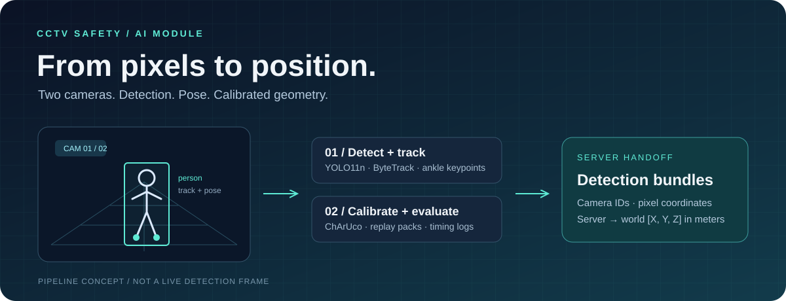
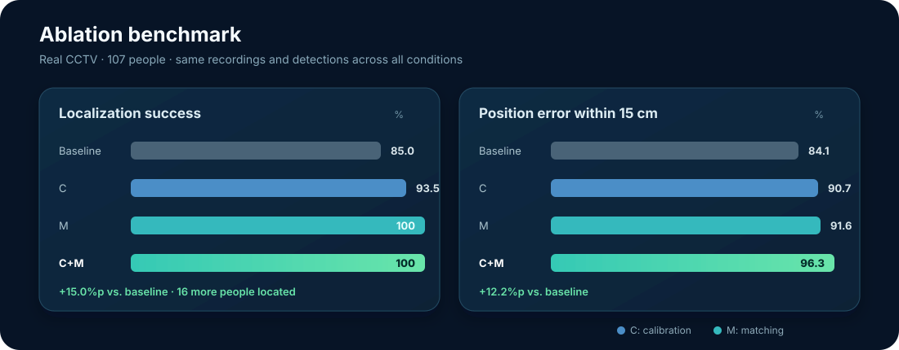

<p align="center">
  
</p>

<h1 align="center">CCTV Safety · AI</h1>

<p align="center">
  <strong>두 카메라의 영상에서, 현장 속 위치까지.</strong><br>
  YOLO 탐지·추적 · 발목 키포인트 · 카메라 캘리브레이션 · 실측 평가
</p>

<p align="center">
  <a href="https://www.python.org/"></a>
  <a href="https://github.com/ultralytics/ultralytics"></a>
  <a href="https://opencv.org/"></a>
  
</p>

<p align="center">
  <a href="#빠른-시작">빠른 시작</a> ·
  <a href="#실측-결과">실측 결과</a> ·
  <a href="#폴더-구조">폴더 구조</a> ·
  <a href="#실험-재현">실험 재현</a> ·
  <a href="#속도-측정">속도 측정</a>
</p>

---

## 한눈에 보기

산업현장 안전관제를 위한 **엣지 탐지·전송, 캘리브레이션, 성능 평가** 모듈입니다. 엣지는 픽셀 좌표를 보내고, 서버가 카메라 간 대응과 월드 좌표 계산을 담당합니다. 위 이미지는 처리 흐름을 설명하는 개념도입니다.

| 모듈 | 하는 일 | 주요 코드 |
| --- | --- | --- |
| 🎥 Edge | 두 카메라 수신, 탐지·추적, 발 위치 추정, 서버 전송 | [realtime.py](edge/realtime.py) · [detector.py](edge/detector.py) |
| 📐 Calibration | ChArUco 렌즈 보정, 장소별 캘리브레이션 생성·등록 | [가이드](calibration/README.md) |
| 📊 Evaluation | 녹화 재생, 조건별 위치 오차 비교, 시간 통계 | [run_experiment.py](eval/run_experiment.py) · [timing_summary.py](eval/timing_summary.py) |

## 빠른 시작

**이 문서의 실행 명령은 `ai/` 폴더 기준**입니다. Python 환경을 준비한 뒤 의존성을 설치합니다.

```bash
# 저장소 루트에서
cd ai
python -m pip install -r requirements.txt

# 웹캠으로 탐지·추적 확인
python edge/detector.py --source 0 --show

# 저장된 영상으로 확인
python edge/detector.py --source path/to/video.mp4 --save
```

처음 실행하면 YOLO 가중치를 다운로드합니다. 카메라·영상 경로는 실행 환경에 맞게 바꿉니다. 두 카메라를 서버와 연결할 때는 [캘리브레이션 가이드](calibration/README.md)와 [메시지 계약](../docs/specs/message-spec.md)을 먼저 확인하세요.

## 실측 결과

<p align="center">
  
</p>

| 조건 | 위치 추정 성공 | 평균 오차 | 15 cm 이내 |
| --- | ---: | ---: | ---: |
| 기준 | 91 / 107 | 7.26 cm | 84.1% |
| 렌즈 캘리브레이션 | 100 / 107 | 6.89 cm | 90.7% |
| 매칭 개선 | 107 / 107 | 8.39 cm | 91.6% |
| **두 방법 결합** | **107 / 107** | **7.05 cm** | **96.3%** |

2026-10-31 공유된 **실측 107명 참고 결과**이며, 현재 체크아웃을 새로 실행한 결과는 아닙니다. 캘리브레이션은 `calib-classroom-1014-2x2b.json`을 사용했고, basic은 바닥 십자만, precise는 ChArUco 내부 파라미터를 사용했습니다. 재현 절차는 아래에 정리했습니다.

## 폴더 구조

주요 코드는 `edge/`, `calibration/`, `eval/`로 나뉩니다.

<details>
<summary>파일별 역할 펼쳐 보기</summary>

```
ai/
├── edge/                    실제 파이프라인
│   ├── realtime.py            카메라 2대 수신 → 프레임 짝짓기(수신 시각 50ms) → 녹화·탐지·서버 전송
│   ├── detector.py            YOLO11n(COCO) 탐지 + 카메라별 ByteTrack 추적
│   ├── feet.py                발 위치: YOLO11n-pose 두 발목 중점 (신뢰도 낮으면 박스 하단)
│   ├── bundle.py              서버로 보낼 탐지 묶음 만들기
│   ├── camera_source.py       RTSP·웹캠·영상 입력
│   ├── unity_reader.py        Unity·녹화 폴더 읽기 → 탐지 → 서버 전송
│   ├── unity_calibration.py   Unity cameras.json → K, rvec, tvec
│   └── server_client.py       서버 전송 (실패 기록, 응답 저장)
├── calibration/             카메라 캘리브레이션
│   ├── capture_charuco.py, calibrate_camera.py   ChArUco 렌즈 캘리브레이션
│   ├── calibrate_grid.py, build_calibration.py   장소 캘리브레이션
│   ├── register_calibration.py, recompute_sessions.py  서버 등록·조건별 재계산
│   ├── results/               cam1·cam2 렌즈 값 (ChArUco)
│   └── output/                장소별 캘리브레이션. 논문 최종은 calib-classroom-1014-2x2b.json
├── eval/                    성능 평가
│   ├── run_experiment.py      pack을 서버에 다시 보내 조건별 비교표 만들기
│   ├── real_pack.py           실측 정지 프레임 pack 만들기
│   ├── eval_position.py       추정 위치 vs 정답 오차
│   ├── eval_detection.py      탐지 성능
│   └── packs/                 저장한 탐지 묶음 (real-* = 실측 15개, s1~s4 = Unity)
├── scripts/, train.py, configs/   자체 학습 데이터·모델 (최종 실험은 COCO 원본 사용)
├── tests/                   단위 테스트
├── tools/                   테스트 보조 도구
├── datasets/                (git 제외) 자체 학습 데이터
└── runs/                    (git 제외) 녹화·탐지·실험 결과
```

</details>

## 실험 재현

실측 2×2 실험을 재현하는 순서입니다. 경로와 서버 주소는 보유한 데이터와 실행 환경에 맞게 바꿉니다.

### 1. 녹화 영상에서 탐지 결과 생성

```bash
# YOLO 탐지로 시간이 걸릴 수 있습니다.
python edge/unity_reader.py runs/real/classroom/s1/t1 --dry-run
```

### 2. 탐지·정답·캘리브레이션을 pack으로 묶기

```bash
python eval/real_pack.py --edge runs/edge/classroom-1014-s1-t1-v5 \
    --gt runs/gt/classroom-1014-v2/diy-1014-s1-t1/frames.jsonl \
    --calib calibration/output/calib-classroom-1014-2x2b.json --name real-s1-t1 --force

```

### 3. 네 조건 비교

기준 방법, 렌즈 캘리브레이션, 매칭 개선, 두 방법 결합을 비교합니다.

```bash
python eval/run_experiment.py run --server http://<서버>:32130 --packs real-s1-t1 --label real-2x2-v4

```

### 4. 조건 간 통계 검정

논문 Ⅳ장의 Wilcoxon·TOST p값을 계산합니다.

```bash
python eval/compare_conditions.py runs/experiments/real-2x2-v4

```

### 5. 검출 예시 그림 생성

팩 이름과 프레임 쌍 번호를 지정합니다. 결과는 `runs/figures/`에 저장됩니다.

```bash
python eval/draw_detections.py real-s10-t1 604
```

## 속도 측정

녹화를 실제 속도로 재생하거나 실제 카메라로 탐지·전송한 뒤, 프레임 쌍마다 걸린 시간을 확인합니다.

### 1. 입력 선택

**녹화 재생** — 10/14 녹화 15개를 차례로 재생합니다. 서버 없이 엣지만 확인하려면 `--dry-run`을 사용합니다.

```bash
python edge/replay_all.py --version v6 --server http://<서버>:32130 \
    --sessions calibration/sessions/classroom-1014-v6.txt

```

**실제 카메라** — 프레임 쌍별 시간이 `runs/edge/<session_id>/timings.jsonl`에 기록됩니다.

```bash
python edge/realtime.py --cam1 tapo:<cam1 IP> --cam2 tapo:<cam2 IP> --seconds 600 --show \
    --send --server http://<서버>:32130 --session <session_id>

```

### 2. 시간 통계 확인

중간값(P50), 90백분위값(P90), 최댓값을 표시합니다. 모델 준비에 사용하는 첫 5쌍은 시간 통계에서 제외합니다.

```bash
python eval/timing_summary.py runs/edge/<session_id> [runs/edge/<다른 세션> ...]
```

### 지표 읽는 법

| 지표 | 기록 필드 | 측정 구간 |
| --- | --- | --- |
| 대기 | `wait_ms` | 프레임 쌍 생성 → 탐지 시작 |
| 검출 합 | `yolo_ms` | 두 카메라의 물체 검출·추적 시간 합 |
| 포즈 합 | `pose_ms` | 두 카메라의 발목 추정 시간 합 |
| 탐지 합 | `detect_ms` | 두 카메라의 검출·포즈·정리 시간 합 |
| 엣지 전체 | `age_ms` | 프레임 수신 → 서버 전송 큐에 넣기 |
| 서버 왕복 | `rtt_ms` | 요청 전송 → 응답 수신 |

- `age_ms`와 `rtt_ms`는 각각 위 구간을 측정하며, 카메라 촬영부터 화면 표시까지의 전체 지연을 뜻하지 않습니다.
- 상태·실패 건수는 예열 구간을 포함한 모든 기록으로 집계합니다. 시간 통계만 첫 5쌍을 제외합니다.
- 같은 `session_id`의 기록 폴더가 이미 있으면 시작하지 않습니다. 다시 측정할 때는 세션 버전을 올립니다(예: `v7`).

자세한 기록 형식은 [realtime.py](edge/realtime.py) 상단 설명을 참고하세요.

## 저장 위치와 전송 규칙

| 데이터 | 저장 위치 |
| --- | --- |
| 원본 녹화 | `runs/real/` |
| 탐지·전송 결과 | `runs/edge/` |
| 조건별 실험 결과 | `runs/experiments/` |

서버는 같은 세션·프레임 쌍의 중복 전송과 같은 세션의 실험 조건 변경을 `409`로 거절합니다. 요청·응답 형식은 [메시지 계약](../docs/specs/message-spec.md)을 확인하세요.

## 관련 문서

| 문서 | 내용 |
| --- | --- |
| [프로젝트 소개](../README.md) | 전체 시스템과 서버 실행 |
| [캘리브레이션](calibration/README.md) | 카메라 보정과 서버 등록 |
| [폴더 구조](#폴더-구조) | 녹화·탐지·평가 결과 저장 위치 |
| [탐지 API](../docs/detections-api.md) | 서버 요청·응답 계약 |
| [협업 규칙](../CONVENTION.md) | 브랜치·커밋·PR 기준 |

<details>
<summary>README 디자인 참고</summary>

[Ultralytics](https://github.com/ultralytics/ultralytics)와 [FastAPI](https://github.com/fastapi/fastapi)의 이미지 헤더, 기술 배지, 빠른 탐색 구성을 참고했습니다. 배너는 이 모듈을 위해 작성한 SVG이며, 실측 차트는 저장소의 기존 자료를 사용합니다.

</details>
