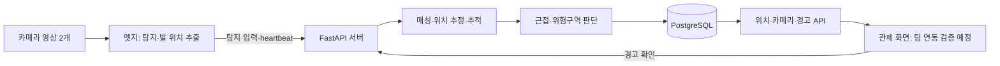

# SW 등록 명세서 백엔드 원고 초안

작성일: 2026-11-12. 대상: `feat/server-week2-dashboard`, PR #83의 서버 구현. 프로그램 전체 이름·창작 완성일·저작자 표기는 팀과 학교 양식에서 확정한다. 이 문서는 백엔드 설명 초안이며 시스템 전체의 완성 확인서가 아니다.

## 목적과 구성

서버는 두 카메라에서 수집한 객체 탐지 정보를 받아 카메라 간 동일 객체를 연결하고 월드 좌표와 추적 ID를 계산한다. 위치와 위험 판단 결과를 데이터베이스에 저장하고 관제 클라이언트가 조회할 API를 제공한다. 서버가 받는 입력은 영상 파일 자체가 아니라 엣지가 추출한 탐지·발 위치 등의 정보다.

## 주요 기능 설명

### 위치 추정과 추적 ID (F3)

카메라별 내부·외부 파라미터와 탐지 결과를 이용해 두 영상의 대응 객체를 매칭한다. 기본 알고리즘은 에피폴라 기하를 사용하며, 두 카메라의 발 위치 등으로 삼각측량하거나 설정된 평면에 투영해 위치를 계산한다. 좌표는 미터 단위 `[X, Y, Z]`이고 Z가 높이다. 관제 위치·거리·구역 판정은 월드 XY 평면을 사용한다. Unity 입력은 엣지에서 좌표축을 변환한다.

객체별 카메라 추적 ID와 서버 객체 ID의 연결을 저장한다. 개선 알고리즘에는 바닥 위치 기반 매칭·추적, 단일 카메라 보완, 경고 유지 등의 선택 기능이 구현돼 있다. 현재 실시간 `POST /detections`는 baseline 결과를 생성하고 improved 결과는 저장 입력의 재계산 API를 사용한다. 관제 조회의 algorithm만 바꿔 실시간 계산 방식을 바꿀 수는 없다.

### 근접 경고와 위험구역 (F4)

위치가 계산된 객체 쌍 중 사람–사람·사람–물체의 XY 거리를 계산한다. 기본값은 1.0m 미만 warning, 0.5m 미만 danger다. 물체–물체는 근접 경고 대상에서 제외한다. 상대 위치·속도로 위험 거리 도달 예상 시간(TTC)도 계산할 수 있으며 계산할 수 없으면 null이다. 경고 유지 기능은 경계 주변의 반복 전환을 완화한다.

위험구역은 같은 좌표계의 다각형으로 저장한다. 사람의 위치가 내부·경계이면 intrusion, 외부에서 주의 거리 이내이면 warning으로 판단한다. 비활성 구역과 비사람 객체는 구역 판정에서 제외한다. 구역 변경은 revision으로 충돌을 확인하고 이전 snapshot을 무효화한다.

전체 위험 분석의 운영 기본값은 false다. 이번 근접 데모는 별도 서버 프로세스에서만 true로 실행했다. 기본 improved 기능 cdfg의 F는 전체 위험 분석이 꺼져 있어도 사람–사람 경고를 계산할 수 있다. 위험구역의 snapshot 판정은 별도 경로이며 전체 위험 분석 환경변수와 동일한 스위치로 설명하지 않는다. 안전모·안전조끼 판별은 이번 등록 검증 범위에 포함하지 않는다.

### 관제 데이터와 경고 확인 지원 (F2·F5 서버 측)

최신 성공 입력의 위치·판단 결과를 snapshot으로 제공한다. 탐지 결과와 snapshot은 같은 트랜잭션으로 저장하고 중복·실패 입력으로 새 snapshot을 발행하지 않는다. 조회는 session_id·calibration_profile·algorithm 조건으로 분리한다. SSE도 제공하지만 이번 첫 프론트 연동은 500ms polling을 기준으로 한다.

heartbeat는 탐지 저장과 독립적으로 보관한다. 서버 수신 후 3초 미만이면 online, 이후 offline, 기록이 없으면 unknown(null)이다. 프레임 관측 최신성과 heartbeat 연결 상태를 구분한다. 파일 재생의 online은 재생 프로세스 응답 상태이며 물리 카메라 연결을 의미하지 않는다.

경고는 발생 ID별로 영속 저장한다. 경고 확인은 위험 해제와 별개이며 무전·출동·오탐 또는 단순 확인을 기록할 수 있다. 종료된 danger도 미확인이면 조회에 남는다. warning에서 danger로 상승하면 같은 발생 ID의 확인 상태를 초기화하고, 종료 후 재발하면 새 ID를 생성한다. 경고 팝업의 실제 표시와 조작은 프론트 담당과 별도 검증한다.

## API 목록

2026-11-12 실행 서버 OpenAPI와 코드를 함께 확인했다.

| 메서드 | 경로 | 용도 |
| --- | --- | --- |
| PUT | `/cameras/{camera_id}/calibration` | 세션·프로필별 카메라 캘리브레이션 저장 |
| POST | `/cameras/{camera_id}/calibration/solve-pnp` | 대응점을 이용한 카메라 자세 계산 |
| POST | `/detections` | 두 카메라 탐지 입력 저장·baseline 계산 |
| POST | `/sessions/{session_id}/recompute` | 저장 탐지를 다른 프로필·알고리즘으로 재계산 |
| GET | `/sessions/{session_id}/results.csv` | 조건별 결과 내보내기 |
| POST | `/ground-truth` | 평가용 정답 저장 |
| PUT | `/dashboard/configuration` | 조건별 지도·위험구역 최초 등록 |
| GET / PUT | `/dashboard/zones` | 구역 조회·revision 기반 전체 교체 |
| GET | `/dashboard/snapshot` | 최신 위치·판단·경고 snapshot |
| GET | `/dashboard/events` | SSE 최신 snapshot 전달 |
| GET | `/dashboard/cameras` | 카메라 위치·시야·프레임·heartbeat 상태 |
| POST | `/edge/heartbeat` | 엣지 실행·수신 상태 저장 |
| GET | `/alerts` | 진행 경고·미확인 danger 조회 |
| POST | `/alerts/{alert_id}/ack` | 경고 확인·조치 기록 |
| GET | `/health`, `/health/db` | 서버 설정·DB 연결 상태 |

관제 API와 alerts 요청은 동일한 조건 쿼리를 전달한다. snapshot이 없으면 204이고 ack 성공도 204다. 값·에러·요청 예시는 [관제 계약과 데모 절차](week2-dashboard.md)를 따른다. 인증 기능은 현재 추가되지 않았으며 로컬 검증 결과를 공개 운영 적합성 검증으로 해석하지 않는다.

## DB 구성

| 테이블 | 저장 내용 |
| --- | --- |
| cameras | 세션·프로필별 카메라 캘리브레이션 |
| frame_bundles, detections | 원본 탐지 묶음·객체별 입력과 계산 결과 |
| global_objects, track_links | 서버 객체 ID와 카메라 track ID 연결 |
| object_motion_states, floor_tracks | 객체 운동·바닥 추적 상태 |
| track_pair_states, risk_pair_states | 카메라 짝 유지·경고 유지 상태 |
| risk_events | 입력별 객체 쌍 거리·위험 수준 |
| session_settings | 세션·프로필·알고리즘별 처리 설정 |
| dashboard_states | 조건별 지도·구역·snapshot·stream ID·seq |
| dashboard_alerts | 경고 발생·종료·확인·조치 이력 |
| edge_heartbeats | 세션·카메라별 최신 heartbeat와 서버 수신 시각 |
| ground_truth | 평가용 정답 |

DB 변경은 Alembic으로 관리한다. 이번 관제 구현은 0011~0013을 추가하며 현재 head는 0013이다. PostgreSQL CI에서 전체 적용, 스키마 일치, 0010까지 되돌리기와 재적용을 검증했다.

## 개발·실행 환경과 확인 근거

백엔드는 Python, FastAPI, SQLAlchemy, Alembic, NumPy, OpenCV, SciPy, PostgreSQL을 사용한다. Docker 백엔드 기준 Python은 3.11이며 로컬 데모는 Windows Python 3.12·PostgreSQL 16.15로 검증했다. YOLO는 엣지 담당 구성이고 React·TypeScript는 프론트 담당 구성이므로 서버가 직접 추론·화면 렌더링을 수행하는 것으로 기술하지 않는다.

현재 백엔드 자동 테스트는 112개 통과했다. [로컬 PostgreSQL 검증 기록](../benchmarks/2026-11-12-local-dashboard-validation.md)에서는 저장된 강의실 탐지 536개 전송·위치 snapshot 536개·경고 발생 ID 9개·ack 저장 1개와 pack 송신 heartbeat 상태 전환을 확인했다. 서버 재시작 후 데이터 보존도 검증했다. 이 수치는 위치 정확도·실시간 처리 속도·전체 기능 종단 성공률이 아니다.

명세서 최종본에서 별도로 채울 항목은 실제 관제 화면과 팝업 캡처, 실제 영상·heartbeat → 서버 → 프론트 리허설 결과, Unity sc10 확인, 실제 지도 정합, 팀 서버 실행 환경과 창작 완성일이다. 미검증 항목을 구현·연동 완료로 기재하지 않는다.
