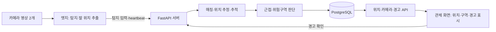

# SW 등록 명세서 백엔드 원고 (통합 전달본)

최초 작성일: 2026-11-12. 최종 반영일: 2026-11-17. 백엔드 코드 기준: `d3079a2` (#82·#83·#84·#85 병합 상태). 11/17 원격 `develop` 최신 `d582713`과 대조했으며 이후 변경은 보호구 모델·평가·문서이고 백엔드 변경은 없다. 명세서 작성·통합은 해민이 담당하며 프로그램 전체 이름·창작 완성일·저작자·학교 양식은 팀 확인을 거쳐 확정한다. 이 문서는 백엔드 담당 전달본이며 SW 등록 제출 완료나 시스템 전체의 완성을 뜻하지 않는다.

## 통합 명세서에 넣을 본문

본 프로그램의 백엔드는 두 카메라의 영상에서 엣지가 추출한 객체 종류, 카메라별 추적 ID, 발 위치와 촬영 시각을 수신하여 동일 객체를 연결하고 미터 단위의 월드 좌표와 서버 객체 ID를 계산한다. 카메라 캘리브레이션 정보를 사용한 에피폴라 매칭·삼각측량과 평면 투영, 추적 상태 유지를 지원한다. 실시간 입력은 기본 알고리즘으로 처리하며, 저장된 탐지 입력은 다른 캘리브레이션 프로필과 개선 알고리즘으로 재계산할 수 있다.

위치가 계산된 사람–사람 및 사람–물체 사이의 거리를 이용해 근접 주의·위험을 판단한다. 공통 기본 거리는 주의 1.0m, 위험 0.5m이며 전체 위험 분석은 설정으로 켜고 끌 수 있다. 같은 월드 XY 좌표계의 다각형 선택 영역을 API로 저장하고, 사람의 영역 접근은 접근 주의(warning), 내부·경계 진입은 침입(intrusion)으로 판단한다. 침입은 위험(danger) 경고로 연결한다. 경고의 발생·종료·사용자 확인과 조치 기록을 데이터베이스에 저장한다.

관제 클라이언트에는 최신 객체 위치·위험 수준·구역·경고를 현재 상태 조회(snapshot)와 실시간 전송(SSE)으로 제공한다. 카메라별 연결 상태 신호(heartbeat)를 탐지 입력과 독립적으로 수신하여 연결 상태를 제공하며, 사용자는 경고 확인 API로 확인 사실과 조치를 기록할 수 있다. 데이터는 PostgreSQL에 저장하고, 처리 결과를 CSV로 내보내 비교·평가할 수 있다. 서버는 Python과 FastAPI로 구현하며 SQLAlchemy·Alembic으로 데이터 저장과 스키마 변경을 관리한다.

본 등록 범위는 위치 추정·추적, 근접·구역 판정, 관제 데이터 제공, 경고 저장·확인이다.

## 내부 검토 메모 (등록 서류에 복사하지 않음)

11/17 후속 반영: #92가 develop에 병합됐고 `f03bbde` 자동 배포·실험이 성공했다. 보호구 서버 상태 제공은 반영됐지만 엣지 #90은 아직 open이므로 등록용 본문에서 보호구를 제외하는 결정은 유지한다. 아래 11/17 초기 확인과 11/15 구현 표는 당시 기록이다. 최신 통합 진행·화면 초안·제출 전 확인표는 [통합 명세서 원고](sw-registration-integrated.md)를 따른다. DB 최신 head는 0014다.

11/17 최신 원격 `develop`에는 보호구 모델 v1(#89)이 병합됐으나 사람 ID별 보호구 상태 서버 구현 `55ffc27`은 별도 로컬 브랜치에 있다. 현재 등록용 본문에는 보호구를 포함하지 않는다. 제출 직전 모델·엣지 전송·서버 상태 제공의 develop 반영 범위를 다시 확인해 포함 여부를 확정한다. 미착용 경고는 별도 구현 여부를 확인한다.

아래 구현·검증 기록과 일정은 내부 확인용 자료다. 등록 서류에는 위 본문과 제출 시점에 확정된 기능 설명만 옮긴다. 화면의 0.5초 간격 조회 설명은 화면 원고에서 다룬다.

## 목적과 구성

서버는 두 카메라에서 수집한 객체 탐지 정보를 받아 카메라 간 동일 객체를 연결하고 월드 좌표와 추적 ID를 계산한다. 위치와 위험 판단 결과를 데이터베이스에 저장하고 관제 클라이언트가 조회할 API를 제공한다. 서버가 받는 입력은 영상 파일 자체가 아니라 엣지가 추출한 탐지·발 위치 등의 정보다.

## 주요 기능 설명

### 위치 추정과 추적 ID (F3)

카메라별 내부·외부 파라미터와 탐지 결과를 이용해 두 영상의 대응 객체를 매칭한다. 기본 알고리즘은 에피폴라 기하를 사용하며, 두 카메라의 발 위치 등으로 삼각측량하거나 설정된 평면에 투영해 위치를 계산한다. 좌표는 미터 단위 `[X, Y, Z]`이고 Z가 높이다. 관제 위치·거리·구역 판정은 월드 XY 평면을 사용한다. Unity 입력은 엣지에서 좌표축을 변환한다.

객체별 카메라 추적 ID와 서버 객체 ID의 연결을 저장한다. 개선 알고리즘에는 바닥 위치 기반 매칭·추적, 단일 카메라 보완, 경고 유지 등의 선택 기능이 구현돼 있다. 현재 실시간 `POST /detections`는 baseline 결과를 생성하고 improved 결과는 저장 입력의 재계산 API를 사용한다. 관제 조회의 algorithm만 바꿔 실시간 계산 방식을 바꿀 수는 없다.

### 근접 경고와 위험구역 (F4)

위치가 계산된 객체 쌍 중 사람–사람·사람–물체의 XY 거리를 계산한다. 기본값은 1.0m 미만 warning, 0.5m 미만 danger다. 물체–물체는 근접 경고 대상에서 제외한다. 상대 위치·속도로 위험 거리 도달 예상 시간(TTC)도 계산할 수 있으며 계산할 수 없으면 null이다. 경고 유지 기능은 경계 주변의 반복 전환을 완화한다.

위험구역은 같은 좌표계의 다각형으로 저장한다. 사람의 위치가 내부·경계이면 intrusion, 외부에서 주의 거리 이내이면 warning으로 판단한다. 비활성 구역과 비사람 객체는 구역 판정에서 제외한다. 구역 변경은 revision으로 충돌을 확인하고 이전 snapshot을 무효화한다.

전체 위험 분석의 운영 기본값은 false다. 이번 근접 데모는 별도 서버 프로세스에서만 true로 실행했다. 기본 improved 기능 cdfg의 F는 전체 위험 분석이 꺼져 있어도 사람–사람 경고를 계산할 수 있다. 위험구역의 snapshot 판정은 별도 경로이며 전체 위험 분석 환경변수와 동일한 스위치로 설명하지 않는다. 안전모·안전조끼 판별은 이번 등록 검증 범위에 포함하지 않는다.

### 관제 데이터와 경고 확인 지원 (F2·F5 서버 측)

최신 성공 입력의 위치·판단 결과를 snapshot으로 제공한다. 탐지 결과와 snapshot은 같은 트랜잭션으로 저장하고 중복·실패 입력으로 새 snapshot을 발행하지 않는다. 조회는 session_id·calibration_profile·algorithm 조건으로 분리한다. SSE도 제공하지만 이번 첫 프론트 연동은 500ms polling을 기준으로 한다.

heartbeat는 탐지 저장과 독립적으로 보관한다. 서버 수신 후 3초 미만이면 online, 이후 offline, 기록이 없으면 unknown(null)이다. 프레임 관측 최신성과 heartbeat 연결 상태를 구분한다. 파일 재생의 online은 재생 프로세스 응답 상태이며 물리 카메라 연결을 의미하지 않는다.

경고는 발생 ID별로 영속 저장한다. 경고 확인은 위험 해제와 별개이며 무전·출동·오탐 또는 단순 확인을 기록할 수 있다. 종료된 danger도 미확인이면 조회에 남는다. warning에서 danger로 상승하면 같은 발생 ID의 확인 상태를 초기화하고, 종료 후 재발하면 새 ID를 생성한다. 경고 팝업의 실제 표시와 조작은 프론트 담당과 별도 검증한다.

## 11/15 구현 범위와 후속 개발 구분

| 항목 | 현재 구현·확인 범위 | 남은 작업 |
| --- | --- | --- |
| 위치·ID·snapshot | 서버 구현, 저장 탐지 재생 및 s10 실제 엣지 folder 연동 확인 | 실제 교실 실시간 화면 지연·위치 연속성 검증 |
| 충돌 경고·ack | 서버 판정·영속 저장·확인 API, #84 화면 연동 구현 | sc10 danger 팝업 → 사용자 확인 종단 검증·캡처 |
| 선택 영역 | 다각형 조회·저장·비활성화와 서버 판정·경고 연결 구현 | 화면에서 꼭짓점 편집·저장, 실제 침입 재생 검증 |
| 경고 거리 | 사람–사람·사람–물체 공통 1.0/0.5m | 종류별 거리 설정 |
| 보호구 | snapshot의 `vest`는 기본 unknown, `vest_evaluated=false`; `helmet` 필드와 미착용 alert는 없음 | 모델·엣지 입력·ID별 상태 유지·미착용 경고·화면 표시 |
| 경고음·화면 지연 표시 | 현재 화면에 없음 | 프론트 구현·촬영 검증 |
| 지도 정합 | 조건별 좌표계·bounds 저장 지원 | 실제 강의실 원점·bounds와 바닥 테이프 정합 |
| 위험 분석 | 기본 false, 별도 데모에서만 true로 검증 | 운영 활성화 기준 합의 후 별도 적용 |

화면 기능의 구현 근거는 병합된 #84이며, 서버 관찰 기록만으로 실제 화면 팝업·경고음을 검증했다고 간주하지 않는다. 11/16~11/22는 보호구·선택 영역 연동, 11/23~11/29는 실제 교실 검증 일정이다. 목~토 기능 PR 허용 여부는 리뷰 결정 전까지 미정이다.

## API 목록

11/12 실행 서버 OpenAPI 확인 기록을 바탕으로, 11/15 기준 코드의 라우트와 다시 대조했다.

| 메서드 | 경로 | 용도 |
| --- | --- | --- |
| PUT | `/cameras/{camera_id}/calibration` | 세션·프로필별 카메라 캘리브레이션 저장 |
| POST | `/cameras/{camera_id}/calibration/solve-pnp` | 대응점을 이용한 카메라 자세 계산 |
| POST | `/detections` | 두 카메라 탐지 입력 저장·baseline 계산 |
| POST | `/sessions/{session_id}/recompute` | 저장 탐지를 다른 프로필·알고리즘으로 재계산 |
| GET | `/sessions/{session_id}/results.csv` | 조건별 결과 내보내기 |
| POST | `/ground-truth` | 평가용 정답 저장 |
| PUT | `/dashboard/configuration` | 조건별 지도·위험구역 최초 등록 |
| GET / PUT | `/dashboard/zones` | 구역 조회·revision 기반 전체 교체 |
| GET | `/dashboard/snapshot` | 최신 위치·판단·경고 snapshot |
| GET | `/dashboard/events` | SSE 최신 snapshot 전달 |
| GET | `/dashboard/cameras` | 카메라 위치·시야·프레임·heartbeat 상태 |
| POST | `/edge/heartbeat` | 엣지 실행·수신 상태 저장 |
| GET | `/alerts` | 진행 경고·미확인 danger 조회 |
| POST | `/alerts/{alert_id}/ack` | 경고 확인·조치 기록 |
| GET | `/health`, `/health/db` | 서버 설정·DB 연결 상태 |

관제 API와 alerts 요청은 동일한 조건 쿼리를 전달한다. snapshot이 없으면 204이고 ack 성공도 204다. 값·에러·요청 예시는 [관제 계약과 데모 절차](week2-dashboard.md)를 따른다. 인증 기능은 현재 추가되지 않았으며 로컬 검증 결과를 공개 운영 적합성 검증으로 해석하지 않는다.

## DB 구성

| 테이블 | 저장 내용 |
| --- | --- |
| cameras | 세션·프로필별 카메라 캘리브레이션 |
| frame_bundles, detections | 원본 탐지 묶음·객체별 입력과 계산 결과 |
| global_objects, track_links | 서버 객체 ID와 카메라 track ID 연결 |
| object_motion_states, floor_tracks | 객체 운동·바닥 추적 상태 |
| track_pair_states, risk_pair_states | 카메라 짝 유지·경고 유지 상태 |
| risk_events | 입력별 객체 쌍 거리·위험 수준 |
| session_settings | 세션·프로필·알고리즘별 처리 설정 |
| dashboard_states | 조건별 지도·구역·snapshot·stream ID·seq |
| dashboard_alerts | 경고 발생·종료·확인·조치 이력 |
| edge_heartbeats | 세션·카메라별 최신 heartbeat와 서버 수신 시각 |
| ground_truth | 평가용 정답 |

DB 변경은 Alembic으로 관리한다. 관제 구현은 0011~0013을 추가했으며 현재 코드의 head는 0013이다. 기존 PostgreSQL CI 검증 기록은 전체 적용, 스키마 일치, 0010까지 되돌리기와 재적용을 포함한다. 이번 문서 수정에서 DB 마이그레이션을 재실행한 것은 아니다.

## 개발·실행 환경과 확인 근거

백엔드는 Python, FastAPI, SQLAlchemy, Alembic, NumPy, OpenCV, SciPy, PostgreSQL을 사용한다. Docker 백엔드 기준 Python은 3.11이며 로컬 데모는 Windows Python 3.12·PostgreSQL 16.15로 검증했다. YOLO는 엣지 담당 구성이고 React·TypeScript는 프론트 담당 구성이므로 서버가 직접 추론·화면 렌더링을 수행하는 것으로 기술하지 않는다.

11/12 당시 백엔드 자동 테스트 112개 통과 기록이 있으며, 후속 검증 기록에는 재생 도구 테스트가 포함돼 있다. 최신 문서 커밋 `aac8562`의 backend-test·backend-postgres-test·edge-test·frontend-test CI는 모두 성공했다. [로컬 PostgreSQL 검증 기록](../benchmarks/2026-11-12-local-dashboard-validation.md)에서는 저장된 강의실 탐지 536개 전송·위치 snapshot 536개·경고 발생 ID 9개·ack 저장 1개와 pack 송신 heartbeat 상태 전환을 확인했다. 서버 재시작 후 데이터 보존도 검증했다. 이 수치는 위치 정확도·실시간 처리 속도·전체 기능 종단 성공률이 아니다.

### 11/13 실제 강의실 리허설 결과

별도 실습 데모는 Ubuntu 24.04 서버에서 Docker Compose와 Python 3.11 백엔드 이미지, PostgreSQL 16-alpine으로 실행했다. 소스 commit은 `348f5ff`이며 기존 실험 서버·DB와 분리했다. 전체 위험 분석은 이 데모 프로세스에서만 true다. 운영 서버의 false 설정은 유지했다.

근찬의 s10-t1 실제 엣지 folder 재생을 `classroom-1014-s10-t1-v91` / basic / baseline 조건으로 수신했다. [서버 관찰 결과](../benchmarks/2026-11-13-s10-live-integration.md)에서 두 카메라 online·recent, 위치 snapshot 갱신과 warning을 확인했다. 마지막 snapshot은 seq 949 / pair 2043이고 첫 offline 관측은 마지막 heartbeat 수신 후 3.300초·3.273초였다. folder heartbeat는 재생 프로그램의 응답 상태다. 프론트 수신은 팀 회신으로 확인했으며 서버 담당이 화면 영상을 직접 검토한 것은 아니다.

엣지 PR #82의 송신 보고는 탐지 201 응답 949건·heartbeat 204 응답 176건·실패 0이다. 서버 문서의 polling 표본과 구분한다. 이전 저장 파일 재생 822쌍·최소 0.61594m와 이번 실제 재생 결과를 같은 실험 수치로 합치지 않는다.

### 11/14 sc10 준비와 미완료 항목

[준비 증거](../benchmarks/2026-11-14-sc10-live-readiness.json)에 따라 실제 탐지 ZIP의 130묶음과 cam1·cam2 캘리브레이션을 검증하고, `unity-grid-sc10-run1` / basic / baseline에 캘리브레이션·`unity-world-xzy` 지도·합의된 Unity 검토 구역을 등록했다. 근찬의 직접 재생용으로 탐지·heartbeat·ack는 보내지 않았고 snapshot 204 상태다. 이는 danger 발생·팝업·확인 완료를 뜻하지 않는다.

기존 Unity 구역(X/Y 각각 3~4m, 주의 거리 0.5m)으로 sc10 GT 사람 위치 390개를 대조하면 모두 outside다. 따라서 sc10 근접 경고 리허설만으로 위험구역 침입의 실제 장면 검증까지 완료했다고 적을 수 없다. 자동 API 검증과 실제 장면 검증을 구분하고, 합의된 구역과 허용 데이터 중 진입 장면을 확인해야 한다. 강의실은 실제 마커 원점·구역 좌표가 아직 없으므로 기존 진단 지도와 빈 zones를 유지한다.

명세서 최종본에서 별도로 채울 항목은 실제 관제 화면과 팝업 캡처·영상 검토, Unity sc10 danger·ack 종단 결과, 실제 위험구역 진입 장면 검증, 실제 지도 정합, 프로그램 이름·창작 완성일·저작자와 소스코드 제출 범위다. SSE 실환경 검증은 이번 최소 기능 리허설의 필수 완료 조건으로 추가하지 않는다. 보호구 판별·깊은 성능 및 정확도 개선은 스프린트 후속 범위다. PR 병합과 정식 운영 배포는 별도이며 현재의 데모 실행으로 대체 완료 처리하지 않는다.

## 통합 담당 전달과 제출 전 확인

백엔드 본문은 위 「통합 명세서에 넣을 본문」을 사용하고, API·DB 표는 학교 양식의 기능·구성 설명에 맞춰 옮긴다. 엣지 내용은 [엣지·AI 원고](sw-registration-edge.md), 화면 내용은 성윤의 최종 원고와 맞춘다. 백엔드 작성 완료와 서류 제출 완료를 별도 관리한다.

| 항목 | 담당 | 전달 상태·필요한 확인 |
| --- | --- | --- |
| 백엔드 기능·API·DB·환경 원고 | 해민 | 11/15 코드 대조와 통합용 본문 반영 완료, 리뷰 후 전달 |
| 프로그램 이름·창작 완성일·저작자·학교 양식 | 해민·팀 | 미확정; 추정값을 기입하지 않음 |
| 소스코드 제출 범위·기준 커밋 | 해민·각 담당 | 제출본 확정 시 기록; 위 코드 기준은 검토 기준임 |
| 화면 원고·화면 캡처 | 성윤 | 최종본 수령과 실제 화면 대조 필요 |
| sc10 danger → 팝업 → 확인 | 근찬·성윤·해민 | 11/16 공동 검증 예정; 실행 조건·alert_id·ack 응답·화면 증거 기록 |
| 명세서 작성·최종 통합·제출 확인 | 해민 | 11/18 목표; 제출 접수 증거 확인 전 미완료 |

미완료 장면 검증은 결과를 얻은 뒤 증거 링크와 실행 조건을 추가한다. 결과가 없는 기능을 제출본의 검증 완료 항목으로 바꾸지 않는다.

### 엣지·화면 원고 요청 초안 (#87 댓글용, 아직 게시하지 않음)

근찬님, 명세서 작성·통합은 해민 담당으로 수정했습니다. 아래 항목을 엣지는 근찬님, 화면은 성윤님과 함께 정리해주시면 통합하겠습니다.

- 엣지: 입력 영상·두 카메라 처리 흐름, 사람·물체 탐지와 발 위치 추출, 서버 전송 정보·좌표 변환, 실행 환경을 한글 2~3문단(약 500~800자)으로 부탁드립니다.
- 화면: 지도 위 객체·위험구역·카메라 상태 표시, 경고 팝업·사용자 확인 흐름, 0.5초 간격 조회, 실행 환경을 한글 2~3문단(약 500~800자)으로 부탁드립니다. 실제 화면 캡처 2~3장과 짧은 설명도 함께 부탁드립니다.
- 공통: 제출본에 포함할 기능의 develop 기준 커밋과 실제 확인 범위를 알려주세요. 보호구는 제출 직전 통합 여부를 확인해 포함 여부를 정하고, 미구현 기능과 내부 일정은 등록용 본문에서 제외하겠습니다.

### 코드 대조 위치

- [탐지·재계산·설정](../../backend/api.py), [기하 계산](../../backend/geometry.py), [추적](../../backend/tracking.py), [근접 위험 계산](../../backend/risk.py)
- [snapshot 계약·구역 판정](../../backend/dashboard.py), [구역 저장·snapshot·SSE·카메라 API](../../backend/dashboard_api.py), [경고 저장·확인](../../backend/alerts.py), [heartbeat](../../backend/heartbeat.py)
- [DB 모델](../../backend/models.py), [마이그레이션](../../backend/alembic/versions/), [실행 환경](../../backend/Dockerfile), [Compose 기본값](../../infra/docker-compose.yaml), [환경변수 예시](../../infra/.env.example)
- [프론트 API 연결](../../frontend/src/api/httpSource.ts), [위험 팝업](../../frontend/src/components/DangerAlertModal.tsx), [관제 계약](frontend-api.md), [구역 계약](risk-zones.md)
