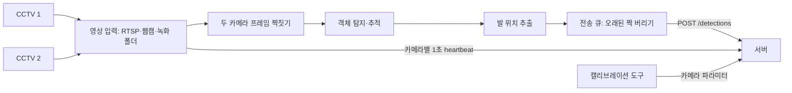

# SW 등록 명세서 엣지·AI 원고 초안

작성일: 2026-11-13. 대상: `feat/edge-week2-freshness`의 엣지 구현과 `ai/calibration` 캘리브레이션 도구. 프로그램 전체 이름·창작 완성일·저작자 표기는 팀과 학교 양식에서 확정한다. 이 문서는 엣지 설명 초안이며 시스템 전체의 완성 확인서가 아니다.

## 목적과 구성

엣지는 현장 노트북에서 CCTV 두 대의 영상을 받아 사람·물체를 탐지하고, 서버가 위치를 계산할 수 있도록 탐지 정보만 보낸다. 영상 원본은 서버로 보내지 않는다. 두 카메라 프레임을 시각 기준으로 짝지어 한 묶음으로 전송하고, 탐지 전송과 별도로 카메라 상태(heartbeat)를 알린다. 카메라 위치·자세를 구하는 캘리브레이션 도구도 함께 제공한다.

## 주요 기능 설명

### 영상 입력과 두 카메라 프레임 짝짓기 (F1)

입력은 RTSP 카메라(Tapo 등), 웹캠, 영상 파일, 녹화 폴더를 지원한다. 카메라마다 별도 스레드로 프레임을 받고, 끊기면 다시 연결한다. 녹화 폴더는 녹화 당시 프레임 간격 그대로 재생해 실시간 입력과 같은 조건으로 시험할 수 있다.

두 카메라 프레임은 노트북이 받은 시각을 기준으로 가장 가까운 것끼리 짝짓는다. 시각 차이가 50ms를 넘으면 짝으로 인정하지 않는다. 카메라 사이 고정 지연은 보정값(`--cam2-offset-ms`)으로 뺄 수 있다. 짝지은 프레임은 선택적으로 저장하며, 시각 기록(`frames.jsonl`)은 항상 남긴다.

### 객체 탐지와 발 위치 추출 (F1)

짝마다 두 카메라 프레임에서 객체를 탐지·추적한다. 기본 모델은 COCO 사전학습 YOLO11n이며 사람·의자·캐리어·가방을 내보낸다. 클래스별 신뢰도 기준을 따로 둔다(기본 사람 0.5, 의자 0.4). 추적은 ByteTrack으로 카메라별 track ID를 유지한다.

서버의 위치 계산 기준점은 발 위치다. 사람은 포즈 모델(YOLO11n-pose)로 찾은 두 발목의 가운데를 쓰고, 발목이 보이지 않으면 박스 아래 가운데로 대신한다. 좌우 발목 좌표도 따로 보내 서버가 같은 쪽 발목끼리 대응할 수 있게 한다. 사람이 아닌 물체는 박스 아래 가운데를 쓴다. 보내기 전에 서버 검증에 걸릴 탐지를 정리한다. 추적 ID가 없거나 서버가 모르는 클래스는 빼고, 박스와 발 위치는 이미지 안으로 자른다.

탐지가 카메라 속도보다 느리면 밀린 짝은 건너뛰고 가장 최근 짝을 탐지한다.

### 실시간 전송과 카메라 상태 알림 (F2)

탐지 결과는 전송 큐에 넣고 백그라운드 스레드가 서버로 보낸다. 네트워크가 느려도 탐지 루프는 멈추지 않는다. 화면까지 1초 목표를 위해, 카메라 수신부터 정해진 시간(기본 800ms)이 지난 짝은 보내지 않고 버린다. 버린 짝은 `stale`로 기록하며 실패로 세지 않는다.

탐지 전송과 별도로 카메라마다 1초에 한 번 heartbeat를 보낸다. 별도 HTTP 연결을 써서 탐지 전송이 밀려도 늦어지지 않는다. heartbeat에는 실행 ID, 실시간·재생 구분, 마지막 프레임 수신 시각, 보낸 시각, 버린 짝 수, 큐 최대 대기 시간이 들어간다. 시각은 시스템 시계 보정으로 뒤로 가지 않는 엣지 시계로 만든다. heartbeat 실패는 세기만 하고 탐지 전송을 멈추지 않는다.

서버가 캘리브레이션 없음·해상도 불일치·중복 등 계속 거절할 이유로 응답하면 이유를 출력하고 기록을 남긴 뒤 멈춘다. 짝마다 대기·탐지·큐·왕복 시간을 기록해 지연 구간을 확인할 수 있다.

### 카메라 캘리브레이션 도구

카메라마다 ChArUco 보드로 렌즈 내부 파라미터를 구하고, 바닥에 놓은 ArUco 마커·십자 격자로 카메라 위치·자세를 구한다. 결과는 서버의 캘리브레이션 등록 형식(`PUT /cameras/{camera_id}/calibration`)으로 만든다. Unity 시뮬레이션 카메라 정보도 같은 형식으로 변환한다.

## 실행 방법

| 용도 | 명령 (`ai/` 폴더) |
| --- | --- |
| 카메라 2대 실시간 전송 | `python edge/realtime.py --cam1 tapo:<IP> --cam2 tapo:<IP> --send --server <주소> --session <session_id>` |
| 녹화 폴더 재생 | `python edge/realtime.py --cam1 <녹화>/cam1 --cam2 <녹화>/cam2 --no-save --send --server <주소> --session <session_id>` |
| 서버 없이 시험 | 위 명령에 `--server` 대신 `--dry-run` (보낸 내용을 파일로 저장) |
| 녹화 여러 개 재생 | `python edge/replay_all.py --version <n> --server <주소>` |
| 속도 표 | `python eval/timing_summary.py runs/edge/<session_id> --detail` |

| 옵션 | 기본값 | 설명 |
| --- | --- | --- |
| `--max-age-ms` | 800 | 카메라 수신부터 이 시간이 지난 짝은 버림. 0이면 끔 |
| `--no-heartbeat` | 꺼짐 | 서버에 heartbeat API가 없을 때 끔 |
| `--foot` | ankle | 발 위치 기준 (ankle / box) |
| `--tol-ms` | 50 | 두 카메라 짝으로 인정할 최대 시각 차이 |

session_id는 `{diy|classroom}-MMDD-s{시나리오}-t{회차}[-v{n}]` 형식만 받는다. 같은 session_id의 기록 폴더가 있으면 기록이 섞이지 않게 시작하지 않는다.

## 출력 파일

| 파일 | 내용 |
| --- | --- |
| `runs/real/<이름>/frames.jsonl` | 두 카메라 짝 번호와 수신 시각 |
| `runs/edge/<session_id>/sent_detections.jsonl` | 서버로 보낸 탐지 묶음 |
| `runs/edge/<session_id>/responses_detections.jsonl` | 서버가 계산한 매칭·위치 |
| `runs/edge/<session_id>/timings.jsonl` | 짝별 대기·탐지·큐·왕복 시간과 상태 |
| `runs/edge/<session_id>/failed.jsonl` | 실패한 요청과 서버 응답 |
| `runs/edge/<session_id>/sent_edge_heartbeat.jsonl` | dry-run에서 보낸 heartbeat |

## 개발·실행 환경과 확인 근거

엣지는 Python, Ultralytics YOLO(8.3.0), PyTorch, OpenCV, NumPy, requests를 사용한다. 개발·시험은 Apple Silicon macOS 노트북(MPS 가속)에서 했다. 캘리브레이션 도구는 OpenCV ArUco를 사용한다.

현재 엣지 자동 테스트는 47개 통과했다. 테스트는 YOLO 없이 돌 수 있는 부분(프레임 짝짓기, 발 위치, 전송 큐·버림, heartbeat 필드·주기, 엣지 시계, 캘리브레이션 변환, 속도 집계)을 검사한다.

2026-11-03 강의실 녹화 15개를 실제 속도로 재생해 서버로 보냈다(v7). 3,020짝 모두 정상 응답을 받았고 처리 속도는 초당 약 10.7짝, 엣지 탐지(검출 + 포즈)는 평균 85ms였다. 이 수치는 오래된 짝 버리기·heartbeat 추가 전의 결과다.

2026-11-12 강의실 녹화 s10-t1(87초)을 서버 없이 재생했다. heartbeat는 카메라마다 88번, 0.995~1.005초 간격으로 기록됐고 실패는 없었다. 첫 프레임 전에는 마지막 수신 시각이 비어 있었고, 보낸 시각은 한 번도 뒤로 가지 않았다. 버린 짝은 모델 준비 중이던 첫 짝 1개였다. 이 실행은 서버 응답이 없는 시험이며 실제 서버 연동 결과가 아니다.

명세서 최종본에서 별도로 채울 항목은 실제 서버로의 엣지 재생과 heartbeat 상태 전환, Unity sc10 탐지 결과, 화면 연동 리허설 결과, 엣지 실행 환경의 정확한 버전이다. 안전모·안전조끼 판별은 이번 등록 범위에 포함하지 않는다. 미검증 항목을 구현·연동 완료로 기재하지 않는다.
